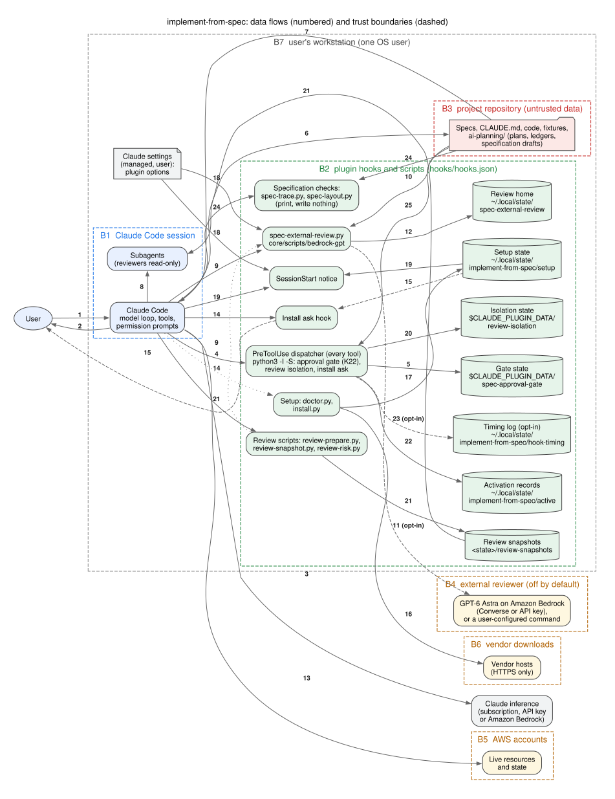

# Threat model

The threat model of the implement-from-spec plugin, on the Four Question Frame: what we are working
on, what can go wrong, what we do about it, and whether that is good enough. It is updated whenever the
approval gate, the external review script or its Bedrock client, the setup installer or the hooks
change (the maintainers' release checklist).

Every control is cited as `file:line` in this repository, as read in the working tree on 2026-10-18
after the gate's write rules for tool side effects and its command-substitution fix, and after the fixes
for the gaps a pass with the threat-modeling MCP server found (TM-45 to TM-54); the external reviewer's
citations were re-pointed on 2026-10-19, when its default became `off` (TM-17, TM-42, TM-44, TM-56). On
2026-11-12, after the security fixes from the triage of pull request 1 (the review model and the PreToolUse
dispatcher), the citations of TM-06, TM-08, TM-15, TM-40, TM-42, TM-47 and TM-55 were re-read and TM-57 to
TM-60 added; after the second round of fixes the same day (an independent review of the first), TM-06, TM-08,
TM-15, TM-40, TM-55 and TM-57 to TM-60 were re-cited and narrowed to what the code and its tests establish,
and TM-61 and TM-62 added; after the third round (an independent review of the second), TM-08, TM-15, TM-55,
TM-57, TM-59 and TM-61 were re-cited and extended to unreadable state, the snapshot binding of `--policy-dir`,
the single read of each policy file, the timing log's cap and Terraform's JSON syntax; after the fourth (an
independent review of the third), TM-08, TM-15 and TM-59 were re-cited and extended to failure handlers that
always reach their denial, the snapshot id and ancestor base of a `--files` review, and the module search's
exit status; after the pull request's code review, TM-55 and TM-58 were re-cited and extended to the
reviewers' `grep` and `rg` option allowlist and to the outputs the IaC reviews attach to a snapshot; after
the seventh round (six change requests of that review), TM-08, TM-55, TM-58 and TM-62 were extended to the
Skill name the hooks share, the option allowlists of `sort`, `wc`, `file`, `diff` and `find`, the snapshot's
policy copies and the escaped reviewer briefs, and the citations into the files it changed were re-pointed in
TM-06, TM-15, TM-40, TM-47, TM-57, TM-60 and TM-61. On 2026-11-13, for the 0.2.0 release (the re-read the
release checklist asks for, since `core/` and `hooks/` changed after 0.1.0), every row from TM-01 to TM-62,
the data flows and section 4 were re-read against the code of that day's working tree: every `file:line` was
re-pointed to the code it names, a bare `:NNN` that follows a citation of another file now repeats its file,
the statements the code no longer supported were corrected (the scope list, TM-40, TM-47 and the residual
summary among them), and data flows 21 to 23 (the review snapshots, the activation records and the timing
log) were added. On 2026-11-24, with specification handling (the spec-handling skill, its `gate_rules.json`
and `core/scripts/spec-layout.py`), TM-63 to TM-70 were added, data flows 6 to 8 and 10 were extended to
the specification draft and to specifications the plugin itself derived, data flow 24 (the specification
checks) was added, and the citations into `core/contract.md`, `README.md`, `core/scripts/spec-trace.py`
and the Terraform skill, whose lines had moved, were re-pointed, TM-40's included. TM-66 (the draft not
bound by the approval) and TM-70 (a specification under an unrecognised name) were first written against
fixes the maintainer had decided but not yet landed; the same day they landed (the draft digest and the
byte-for-byte check of drafted files, the candidate specification files, the baseline survey, the secret
check, the escaped report and its move into place), and TM-17, TM-40, TM-62 to TM-70 and the data flows
were re-cited against them. The same day the gate itself changed (the maintainer's decision): it binds a
plan's specification draft to the approval (TM-66, data flow 25), and it spells every path it compares as
the file system holds it, which closes gaps 0.1.0 and 0.2.0 shipped with: on a case-insensitive
volume a path in another case, and on macOS a firmlinked alias, was allowed before approval, an
upper-case program name (`RM`, `CP`) was not analysed, and inline interpreter code under a quoted or
upper-case interpreter name was not seen as a write (TM-03, TM-06, TM-07, TM-08); every row was then
re-cited against that day's tree. The reviewer isolation and the setup ask hook were then brought to the
same comparison: the isolation hook spells every path and root it compares as the file system holds it and
compares credential names folded, and the ask hook matches `install.py` in any letter case (TM-31, TM-55).
Also on 2026-11-24, for the dependency audit of Java reviews, TM-71 to
TM-79 and data flows 26 and 27 were added, TM-06 was extended to the audit's directories in the gate's
protected set, and A8 and B6 were extended. Line numbers drift as code moves; each citation also names the function or constant, so it can be found again, and the
release checklist re-reads them. Where a security review of the documentation raised the same threat,
its theme number is given in the Theme column; the scan results, their triage and the residual risk
recorded for each theme are kept in the maintainers' release record and are not repeated here.

## 1. What are we working on?

A Claude Code plugin that runs on the user's workstation. Its skills turn specification items into a
plan, wait for the user's approval, implement, check and review, and stop short of deploying.

**Scope: what a release ships.** A release is the full plugin without the maintainers' test harness:
no `test/`, `evals/`, `tools/` or `core/**/tests/` directory is part of it. The unit tests, the eval
suites and their fixtures, the test container and the end-to-end scripts therefore run only on the
maintainers' machines; their threats are out of scope here (section 5). What ships:

- hooks (`hooks/hooks.json`, `hooks/hooks.json:3-14`): one PreToolUse dispatcher,
  `core/gate/ifs-pretool.py`, on every tool call (`python3 -I -S`, matcher `*`, `onFailure: block`, `:4`),
  which runs the approval gate's `core/gate/spec-approval-gate.py` guards and skill activation, the reviewer
  isolation `core/gate/review-isolation.py` and the setup ask hook `core/deps/install-ask-hook.py`
  in-process, their state located and their paths spelled on disk by `core/gate/ifs_paths.py`, a plan's
  specification draft digested by `core/gate/draft_digest.py` (which `spec-layout.py` loads too); the gate
  again on every prompt and after
  plan writes (`:7`, `:13`); and the SessionStart notice `core/deps/session-notice.py` (`:10`), all
  started as `python3 -I`
- scripts: `core/scripts/spec-trace.py` (read-only traceability), `core/scripts/spec-layout.py` (finds the
  project's specification, checks it or a draft of it against the plan's records, and prints the
  traceability report; it writes nothing), `core/scripts/review-prepare.py`,
  `core/scripts/review-snapshot.py` and `core/scripts/review-risk.py` (the review's preparation, its
  snapshot, records and state block, and its risk classification), `core/scripts/dependency-audit.py` and
  its Gradle init script `core/scripts/dependency-audit-graph.init.gradle` (the Java reviews' dependency
  audit), `core/scripts/spec-external-review.py` and `core/scripts/bedrock-gpt` (the external review; the
  plugin ships no `bin/` directory, TM-48), `core/deps/doctor.py`, `core/deps/install.py` and
  `core/deps/depslib.py` (setup)
- data the scripts read: every skill's `gate_rules.json` (the gate's command rules), each reviewing
  skill's `references/dispatch.json` (which reviewers a review dispatches, and for Java the required gate
  `dependency-audit`), `core/deps/dependencies.json` (setup recipes) and the public advisory data the
  dependency audit downloads or imports (flow 26)
- skills (the reviewer skills and `spec-handling` included; the plugin ships no agents) and reference
  files, which are instructions to Claude, not code that runs

It runs nothing as a service, opens no port, stores no credential and has no third-party runtime
dependency (Python standard library only). The dependency audit runs the project's own build tool (TM-74).

### Data flows

The numbers are the edges of the diagram (source: [`threat-model.dot`](threat-model.dot)).

1. User to Claude Code: prompts, and the approval reply
2. Claude Code to user: the plan, questions, permission prompts (the gate's `ask` decisions)
3. Claude Code to Claude inference: the conversation, including repository content Claude read. This is
   Claude Code's own channel to the provider the user chose, not a plugin flow
4. Claude Code to the gate: hook payloads (PreToolUse for every tool, through the dispatcher, which
   passes them to the guards, the skill activation, the reviewer isolation and the install ask;
   UserPromptSubmit; PostToolUse for Write, Edit and MultiEdit) and one deny, ask or allow back
5. Gate to its state directory (`spec-approval-gate/` under `CLAUDE_PLUGIN_DATA`, else under
   `${XDG_STATE_HOME:-~/.local/state}`; `STATE_DIR`, `core/gate/spec-approval-gate.py:274`, from
   `gate_state_dir`, `core/gate/ifs_paths.py:92`): registered repositories, plan sha256 values and
   approvals (with the draft's digest and file list for a plan that has a specification draft), per
   session
6. Claude Code to the project repository: reads; writes (only `ai-planning/` and `.claude/` before
   approval). A specification the skills add or change is drafted there first, under
   `ai-planning/<slug>.spec/`, and specification files are written only after approval, copied from that
   draft, which the approval binds through the plan's `Draft digest:` line (TM-63, TM-64, TM-66); the
   traceability report reaches `TRACEABILITY.md` through a temporary file under `ai-planning/` and a move
   (TM-67)
7. Project repository to Claude Code: specifications, CLAUDE.md, code, the project's own fixtures, tool
   output. A specification the plugin derived from the code in an earlier session comes back on this
   flow, as data like the rest (TM-63)
8. Claude Code to subagents and back: briefs out, findings and status blocks in; spec-handling's baseline,
   survey and evidence-check subagents are generic subagents, not registered reviewers: the baseline one
   writes under its draft before approval, the others are read-only by their brief (TM-63)
9. Claude Code, through a generic subagent that loads the read-only `running-external-review` skill, to
   `spec-external-review.py`; with the reviewer off, the default, the review's preparation runs the script
   itself and no runner starts (`run_external_off`, `core/scripts/review-prepare.py:634`)
10. The repository to `spec-external-review.py`: the change, the plan, the review focus and the context
    files; the rules come from the review snapshot's `policy/` copy, which the skills pass as `--policy-dir`
    (TM-15). The change and the context files include the specification files the change wrote, a
    baseline derived from the whole code base included (TM-69)
11. `spec-external-review.py` to the external reviewer, only when the user has enabled it (`off` is the
    default since 2026-10-19; off, the flow carries nothing): the filtered change in nonce-delimited
    sections; the verdict and findings back. In `aws-profile` mode the AWS CLI calls Bedrock Converse, in `api-key`
    mode `core/scripts/bedrock-gpt` calls the Bedrock endpoint with curl, in `command` mode the user's command runs
12. `spec-external-review.py` to the review home (`$SPEC_REVIEW_HOME`, else `spec-external-review/` under
    `CLAUDE_PLUGIN_DATA` when set, else under `${XDG_STATE_HOME:-~/.local/state}`,
    `REVIEW_HOME`, `core/scripts/spec-external-review.py:166-168`): `review.md` with change and prompt
    digests. The script runs through the Bash tool, which does not receive `CLAUDE_PLUGIN_DATA`
    (`docs/design-notes.md:145-148`), so the XDG location is the usual one
13. Claude Code to AWS accounts: targeted plans, diffs and change sets (live reads); deploys only after
    the user approves the command
14. Claude Code to setup: `doctor.py`, the `install.py` dry run, then `--apply --confirm <digest>`,
    intercepted by the ask hook
15. Ask hook to user: the plan summary in the permission prompt, rendered from the dry run saved in the
    setup state directory only after the saved plan is checked against the digest (TM-50)
16. Setup to vendor hosts: downloads over HTTPS (the hosts are listed per recipe in
    `core/deps/dependencies.json`)
17. Setup to its state directory (`${XDG_STATE_HOME:-~/.local/state}/implement-from-spec/setup/`,
    `core/deps/depslib.py:697-709`): the doctor's result, journal, `owned.json`, saved plans and
    downloaded scripts
18. Claude settings to the plugin's scripts: the review script, its `--show-config` (which setup runs to
    read the reviewer configuration) and the notice read the plugin options from the managed and user
    settings files only (`saved_options`, `core/scripts/spec-external-review.py:1122-1133`)
19. Claude Code to the SessionStart notice, which reads the doctor's saved result from the setup state
    directory and returns at most one line of context
20. Dispatcher to the isolation state (`review-isolation/` under `CLAUDE_PLUGIN_DATA`, located by
    `core/gate/ifs_paths.py`): which subagents of a session loaded a reviewer skill, and each call denied to
    them
21. Claude Code, through the Bash tool, to the review scripts (`review-prepare.py`, `review-snapshot.py`,
    `review-risk.py`), and those to the review snapshot directory (`<state>/review-snapshots/<id12>`,
    `<state>` being `CLAUDE_PLUGIN_DATA`, else `${XDG_STATE_HOME:-~/.local/state}/implement-from-spec`;
    `state_dir`, `core/scripts/review-snapshot.py:248`): the manifest with the change's digests, the policy
    files at the base, `risk.json`, the reviewer briefs, the gate results and attached outputs, and the
    findings; the three records the state is built from (`gates.json`, `findings.md`, `risk.json`) each
    carry a sha256 sidecar (`RECORD_WRITERS`, `core/scripts/review-snapshot.py:211`); the reviewer subagents
    read it (flow 8), and
    `review-snapshot.py state` prints the review's state block from it (TM-58)
22. The gate and the isolation hook to the activation records (`~/.local/state/implement-from-spec/active/`,
    located from `HOME` alone; `active_dir`, `core/gate/ifs_paths.py:117`): which sessions started a gated
    skill and which subagents loaded a reviewer skill, so a lost or moved state is never read as no state
    (TM-55, TM-61)
23. The PreToolUse dispatcher, the gate's own registrations and the install ask hook (not the SessionStart
    notice), only when the opt-in timing variable names a log, to
    `~/.local/state/implement-from-spec/hook-timing/` (`write_timing`, `core/gate/ifs_paths.py:275`): one
    line per call with timestamps, tool names, agent and session ids (TM-57)
24. Claude Code, through the Bash tool, to the specification checks `spec-trace.py` and `spec-layout.py`,
    which read the plan, the specification's files, the draft under `ai-planning/<slug>.spec/` and the
    files git lists, and print their findings, the draft's digest, the files a baseline may read
    (`survey`, with the external review's sensitive-file rule) or the traceability report; they write
    nothing, and the report reaches `TRACEABILITY.md` only through the skill's redirection into a
    temporary file and a move (TM-65, TM-66, TM-67, TM-69)
25. The project repository to the gate: the plan's bytes, whose sha256 the approval binds, and, for a plan
    with a specification draft, every file of `ai-planning/<slug>.spec/`, read to compute its digest on
    the approval reply and again before each write to a drafted path (`bind_draft`, `draft_problem`,
    `core/gate/spec-approval-gate.py:692`, `:791`); the draft's names and bytes are the repository's, so
    the digest refuses unsafe names, symlinks and special files (TM-66)
26. `dependency-audit.py` to the public OSV export of Maven advisories, at most once a day: one anonymous
    HTTPS request to one fixed address, `https://osv-vulnerabilities.storage.googleapis.com/Maven/all.zip`
    (`EXPORT_URL`, `core/scripts/dependency-audit.py:212`), with the script's user agent and, after the first
    download, the date and tag the server gave the copy held, so an unchanged export is not sent again
    (`Store.refresh` `:1237`, `http_fetch` `:1021`); nothing about the project is sent, no coordinate, file or
    name. With `refresh --from` the data comes from a copy the user provides instead (`Store.import_from`
    `:1275`). Either way the validated dataset goes to the advisory cache,
    `~/.local/state/implement-from-spec/advisories/`, located from `HOME` alone (`state_home` `:920`,
    `default_cache_dir` `:926`) (TM-71, TM-72)
27. `review-prepare.py` to `dependency-audit.py register`, which records the gate `dependency-audit` as
    pending in the snapshot (`register_gate`, `core/scripts/review-prepare.py:671`); then the main
    conversation, through the Bash tool, to `dependency-audit.py audit`, which runs the project's build tool
    (Maven, or Gradle with the init script) offline on the working tree or on a revision written out from
    git into a scratch directory, reading the project's build configuration and the build tool's local
    repository or cache; the build tool's raw output to the build-output directory
    `~/.local/state/implement-from-spec/dependency-audit/` (`build_log`, `core/scripts/dependency-audit.py:1880`);
    the text and JSON reports attached to the snapshot and the gate recorded through `review-snapshot.py`
    (`finish_snapshot_audit` `:3029`; flow 21); the text report back to the main conversation (TM-73 to TM-79)

### Assets

- **A1** the project repository's integrity: code, plans and specification files as the user approved them
- **A2** live AWS resources and state in the user's accounts
- **A3** credentials: AWS credentials and profiles, Claude Code's `AWS_BEARER_TOKEN_BEDROCK`, the
  reviewer's `IMPLEMENT_FROM_SPEC_BEDROCK_API_KEY`, `ANTHROPIC_API_KEY`
- **A4** the approval record: the sha256-bound approval, the ledger, the approved-plan snapshots
- **A5** confidentiality of repository content sent to the external reviewer
- **A6** the integrity of the user's machine and tools (setup)
- **A7** the integrity of the plugin's gate, rules, state and scripts
- **A8** the integrity of review verdicts, the dependency audit's result included, and of the report's
  statement of whether the review ran

### Trust boundaries

- **B1** the user and the Claude Code session: only the user's own prompt approves a plan
- **B2** Claude Code and the plugin's hooks and scripts, including how the plugin reaches the user
  (marketplace install, version pin)
- **B3** the project repository: untrusted data, whatever its author intended
- **B4** the external reviewer, off by default: Amazon Bedrock in the user's account, or a command the
  user configured, once the user enables it
- **B5** AWS accounts: live state the user's credentials can change
- **B6** the setup installer and vendor downloads, and the advisory data the dependency audit downloads
  or imports
- **B7** the workstation: every process running as the same operating-system user

## 2. What can go wrong? 3. What are we going to do about it?

STRIDE per boundary. Status: **mitigated** (a control in this repository addresses it), **partial**
(a control exists with a stated residual), **accepted** (with the reason). Threat IDs are stable: an
ID removed from scope is listed in section 5 and never reused.

### B1 — the user and Claude Code

| ID | STRIDE | Threat | Control | Theme | Status |
|---|---|---|---|---|---|
| TM-01 | Spoofing | Claude, a subagent or repository text produces an "approve" that unlocks the repository | Approval is read only from the user's prompt on UserPromptSubmit (`cmd_record`, `core/gate/spec-approval-gate.py:1189`; registered in `hooks/hooks.json:6-7`); AskUserQuestion answers never reach the hook (`core/contract.md:216-217`) | T15 | mitigated |
| TM-02 | Elevation | An ambiguous reply ("approve? no", "approved once tests pass") counts as consent | The whole reply must match the approval grammar (`core/gate/spec-approval-gate.py:1204-1212`); a bare reply approves only when one plan is pending, names are required otherwise (`:1223-1245`) | — | mitigated |
| TM-03 | Tampering | The plan changes between what the user read and what is approved, or after approval | Each Write/Edit of a plan records its sha256 (`cmd_plan_changed`, `core/gate/spec-approval-gate.py:1411-1447`); approval requires the recorded sha256, read once from the bytes the draft's digest line is taken from too (`:1247-1261`); an edit of an approved plan revokes when it starts (`cmd_guard_edit`, `:1293-1296`, through `revoke` `:614`) and any later change revokes for good (`approval_status`, `:593-611`); shell writes to plans are denied (`:50`, `:1391-1394`); a plan is recognised in any case where its repository's volume folds case (`is_plan` `:894`, used at `:1293` and `:1391`; PostToolUse looks at every path through `ai-planning/` in any case, `:1418`), so an edit under another spelling revokes when it starts too (`CaseVariants`); a plan's specification draft is bound with it (TM-66) | T14 | mitigated |
| TM-04 | Repudiation | The user later disputes what was approved | The gate prints the approved plan and its sha256 (`core/gate/spec-approval-gate.py:1264-1274`); amendments snapshot the approved plan as `ai-planning/<slug>.r<N>.approved.md` and the ledger records them (`core/contract.md:273-280`); the record lives in the project's git history and the Claude Code transcript | T14 | accepted: a local single-user tool cannot be tamper-evident against the same user |
| TM-05 | Elevation | An approval given in one session unlocks another (a resumed or parallel session) | Gate state is keyed by session (`session_key`, `state_txn`, `session_active`, `core/gate/spec-approval-gate.py:484-530`); another session stays denied (`:59-60`) | — | mitigated |
| TM-66 | Tampering | The specification written into the project is not the text the user approved. Without the draft binding, the approval binds the plan's sha256 alone (`core/gate/spec-approval-gate.py:49-60`; the comparison in `approval_status` `:603`), while the item text, the index and the documents live in the draft under `ai-planning/<slug>.spec/`, which stays writable before and after approval (`gated` `:1064-1072`); a draft file edited after the approval message was sent, or after "approve" (by a subagent still running, a step steered by tool output or a prompt injection), would be copied into the project as if approved | The gate binds the draft (the maintainer's decision of 2026-11-24; the rule, `core/gate/spec-approval-gate.py:62-105`): on the approval reply it reads the plan's `Draft digest:` line from the same bytes whose sha256 it checks, computes the draft's digest and approves only when the two are equal, refusing a line it cannot read, a line whose draft is missing, cannot be digested or has another digest, and a draft directory whose plan has no line; the approval records the digest and the draft's file list (`bind_draft` `:692`, called at `:1257`; the draft's path, spelled on disk, `draft_dir` `:661`). While the approval holds, a write into the draft, or an explicit one that names `ai-planning/` or the directory holding the draft (its rename or deletion), revokes the approval when the write starts, from Write, Edit, MultiEdit, NotebookEdit and every shell target the analysis resolves, a hard link's source and `cp -l`'s included (TM-07), also when the write never runs (`draft_guard` `:810`, called at `:1290-1291` and `:1395-1396`; `revoke` `:614`), and for the whole command: a shell command that ends an approval is judged again from its first segment without it, so a project write before the draft write is not let through (`cmd_guard_bash`, `:1328-1339`; `judge_segments` `:1346`); PostToolUse reports the revocation, and makes it when the approval was recorded after the write was let through, the user having approved while it ran (`draft_changed` `:1450`, `binds_draft` `:1479`); before a write to a path the approved draft holds a file for (or a directory of one, the repository itself, a file added to the draft since), by its name or through the canonical form, resolved through symlinks and spelled on disk, that the approval recorded for each drafted path whose form differs from its name (a symlinked `specification/`; `draft_aliases` `:743`, `draft_target` `:771`), the gate computes the draft's digest again and, when it differs, cannot be computed, or the target is the draft's own file under another name (a hard link), revokes the approval and denies the write (`draft_problem` `:791`), so a copy reads the approved bytes when it starts; without `draft_digest.py` a plan with any trace of a draft is refused and a drafted write denied (TM-08). The digest is one sha256 over the sorted `<path>\t<sha256>` lines of every draft file, read through directory descriptors anchored at the draft's top directory, every directory and file opened relative to its parent without following a symlink (a file also without blocking) and checked with fstat against what the listing saw, refusing a symlink, a special file, an unsafe name, an unreadable entry and one swapped during the read (`digest`, `core/gate/draft_digest.py:201`; `manifest` `:176`, `_walk` `:148`, `_file_sha256` `:102`, `_check_name` `:82`), and the plan's line is read by `plan_digest`, fenced code masked first (`:253`, `LINE_RE` `:65`); the gate and `spec-layout.py` load the same module (`load_drafts`, `core/gate/spec-approval-gate.py:642`; `load_draft_digest`, `core/scripts/spec-layout.py:248`), and `spec-layout.py digest` prints the line the plan carries (`cmd_digest` `:1289`; `core/contract.md:1083-1092`, `skills/spec-handling/SKILL.md:206-211`), so changing the recorded digest is an edit of the plan, which revokes the approval (TM-03); tested in the gate's suites (`Drafts`, `MissingDraftModule`, `TestDraftBinding`) and the module's (`DigestTests`, `PlanDigestTests`). The skill's checks stay as a second line: `check --draft --plan` fails a missing, duplicated or malformed digest line and one the draft no longer matches (`check_digest`, `core/scripts/spec-layout.py:1070`; `draft-digest-mismatch` `:1087`), refuses a draft that is not the plan's own `<slug>.spec/` (`:1472`), and fails a draft whose plan has no `## Specification changes` (`plan-section` `:1013`); the early-wave task runs that check before it copies anything and stops on any FAIL (`core/contract.md:1103-1110`, `skills/spec-handling/SKILL.md:252-256`); a drafted file is frozen from the apply through verification, and the last wave writes only the sync-owned files, never a drafted file, a `*Source:*` or an item's text (`core/contract.md:1094-1099`, `:335-338`); verification's `check --plan --base` finds the plan's draft beside it, compares its digest with the plan's line again and every drafted file, byte for byte, with the file at its path (`cmd_check`, `core/scripts/spec-layout.py:1303`, `:1352-1357`; `check_applied` `:1092`, `draft-not-applied` `:1108`), and fails when the plan records a digest and the draft has gone (`draft-missing` `:1359`); tested (`test_the_draft_digest_binds_the_draft_to_the_plan`), and on 2026-11-24 the edit that passed before the fix (an approved "MUST reject an empty name with error 400" reworded to "MUST accept an empty name and answer 200") failed `draft-digest-mismatch` on the same scratch repository | — | mitigated by the gate, with residuals (`core/gate/spec-approval-gate.py:94-105`): a write the analysis sees only as somewhere under a directory (git, formatters, inline code, a target it cannot resolve) is checked as a location and revokes only when that location is in the draft, and one that names the repository itself (`rm -r .`, a copy into `.`) re-checks the draft without revoking; a write behind the hook's back (a script file, a hard link made outside the session) revokes nothing; a change between the re-check and the copy's read (a tool call running in parallel, whose own check revokes the approval) is not seen by that copy; a shell or NotebookEdit write into the draft that was let through before "approve" and lands after it gets no PostToolUse record, so it does not end the approval when it lands; a symlink re-pointed after the approval moves a drafted path out of the canonical forms the approval recorded; each is caught at the next write to a drafted path or, after the last one, by the skill's check; the bytes written into the specification are judged only by `spec-layout.py check`'s byte-for-byte comparison with the draft, not by the gate (`check_applied`; `core/contract.md:1129-1132`), so a copy that writes other bytes than the draft holds (a Write with edited text) passes the gate and fails verification after the write; the gate reads every draft file on the approval reply and before each drafted write, so a large draft slows those calls; the sync-owned documents (`TRACEABILITY.md`, the living documents the draft does not hold) are no part of the draft and are judged by their own checks (TM-64, TM-67); the binding proves that what is written is the text the user approved, not that the user read it (TM-63) |

### B2 — Claude Code and the plugin's hooks and scripts

| ID | STRIDE | Threat | Control | Theme | Status |
|---|---|---|---|---|---|
| TM-06 | Tampering | Claude switches the gate off by editing its code, its hook registration, rules or state, the project's `.claude/settings*.json` or `.claude/hooks/`, or the user's Claude settings and hooks | The gate is registered by the plugin's `hooks/hooks.json` in every session (`hooks/hooks.json:4`, `:7`, `:13`); the protected pattern covers the gate's state and its whole directory, `core/gate/` (the dispatcher, the shared `ifs_paths.py` and `draft_digest.py` included), the plugin's `hooks/`, setup's state directory (TM-50) and every `gate_rules.json` (`roots`, `core/gate/spec-approval-gate.py:906`, the pattern `:923-924`), and `plugin_trees` (`:997`) the rest of the installed plugin tree (TM-40), both applied in `gated` (`:1019`) and, for a directory holding them, through `protected_roots` (`:1013`); the other hooks' state, `STATE_WRITE_ROOTS` (`:288`; `state_write_roots`, `core/gate/ifs_paths.py:207`: the isolation hook's reviewer registrations under both state roots, the activation records, the review snapshots under every default root, the timing directory, and the dependency audit's advisory cache and build-output directory, `dependency_audit_dirs` `core/gate/ifs_paths.py:192`, TM-72), is protected the same way, removal and rename of a directory holding it included, and `touches_gate` (`core/gate/spec-approval-gate.py:2190`) denies a shell command that names the gate's state, the registrations or the activation records (TM-61; tested in `TestActivationRecord` and `TestDependencyAuditInGatedSession`); `GUARD_FILES_RE` denies the project's guard files before approval and asks after it (`:316`, matched through `guard_rel` and `guard_match` `:881-891`, `guard_ask` `:1126`); `user_guarded` does the same for the user's settings files and hooks (`:1083`, its pattern `:925`). Every path the gate compares, from Write, Edit, MultiEdit, NotebookEdit and the shell analysis, and every root it compares them with, is first spelled as the file system holds it (`ondisk`, `core/gate/ifs_paths.py:488`; `lookup_folds` `:395`, `name_folds` `:542`; the rule, `core/gate/spec-approval-gate.py:107-128`), and the names the gate looks for itself (the writable prefixes, `.plan`, `.claude/settings*.json` and `.claude/hooks/`, the user's settings and hooks, and in a shell command its state directories and its script) match in any case where their directory folds; so on a case-insensitive volume a path in another case, and on macOS a firmlinked alias (`/System/Volumes/Data/<path>` for `<path>`), is the project path it names, where in 0.1.0 and 0.2.0 both were compared as strings and allowed before approval (fixed 2026-11-24; `CaseVariants`, `TestSpelling`, `TestCaseAndMissingModule`); a path whose directory folds but whose entries cannot be read denies the call (`PathUnknown`, `core/gate/ifs_paths.py:364`) | T15 | mitigated while the gate is registered; outside a gated session these directories are left to Claude Code's permission settings; a firmlink alias on a case-sensitive system volume keeps its spelling; running a symlink to a gate script directly was not verified against `touches_gate`'s runner check (`core/gate/spec-approval-gate.py:2207-2228`; open, not verified) |
| TM-07 | Tampering | A shell command writes past the analysis (variables, substitutions, globs, `find -exec`, `xargs`, interpreters) | Shell analysis of redirections, writers, substitutions and inline code (docstring `core/gate/spec-approval-gate.py:130-162`); an unresolved target counts as a write at the working directory and its repository (`UNRESOLVED`, `:1571`, `:1369-1380`); deny beats ask across segments (`cmd_guard_bash`, `:1303-1343`; `judge_segments` `:1346`); inline interpreter code is recognised by the program word the shell runs, quotes removed, respelled and unwrapped (`'python3'`, `PYTHON3`, `env python3.12`), and a quoted or attached `-c` counts too (`:2052-2059`; `inline_commands` `:2136`, `inline_targets` `:2178`), where in 0.1.0 and 0.2.0 the raw command text decided and such code was not seen as a write (fixed 2026-11-24); `cp -l` and `--link` count as hard links, so their source counts as written (`copy_targets` `:2461`, `:2477-2479`); a program word with a capital letter is spelled as the file system holds the program the shell finds for it, so on a case-insensitive volume `RM`, `CP` or `/BIN/RM` is analysed as the writer it runs, in every execution layer (`program_spelling`, `:2237`; `program_layers` `:2263`), where in 0.1.0 and 0.2.0 an upper-case program name went unanalysed (fixed 2026-11-24; `CaseVariants`); a builtin that changes the shell's own state keeps its spelling (`CD` stays `CD`, since `/usr/bin/cd` changes no directory of the shell; `SHELL_STATE_BUILTINS` `:2234`, `:2259`); see TM-38 and TM-39 for the two analyses added on 2026-10-17 | T15 | partial: a script file run by an interpreter is not inspected (`:158`); a program found only on the Bash tool's PATH, not the hook's, is not respelled (`:2256-2260`); inline code is recognised by `-c`, `-e` or a here-document, so `node -p` and `node --eval` are not seen as inline code (`inline_targets`, `:2183`); the gate guards against mistakes, and containment is Claude Code's sandbox and permission settings (`README.md`, "Security model") |
| TM-08 | Denial of service, Elevation | A hook error opens the gate, or blocks unrelated sessions | A guard that fails denies in a gated session, even on a malformed payload (`run_event`, `core/gate/spec-approval-gate.py:2899`), an activated session whose state was lost included (TM-61); its failure handler prints that denial even when the error came from `core/gate/ifs_paths.py`: each helper it calls runs best-effort and fails closed (a session whose gate cannot be checked counts as gated, a plugin skill whose gate cannot be checked does not start, `gated_skill_named` `:2839`, and every spelling the Skill tool accepts for one is recognised: the gate's activation (`activate` `:1171`, `starting_gated_skill` `:2819`), the dispatcher's selection (`activate_may_decide`, `core/gate/ifs-pretool.py:222`) and the isolation hook read the `skill` input through the one `skill_parts` (`core/gate/ifs_paths.py:139`), which drops the surrounding whitespace and a leading `/` as Claude Code's Skill tool does, where until the pull request's code review the gate read it raw and `/implementing-python-from-spec` or a padded name started the skill ungated (`test_padded_and_slash_prefixed_names_activate`, `test_every_spelling_the_skill_tool_accepts_starts_the_gate`), and the activation records' location falls back to text), where until the fourth fix round the handler could raise while naming the records and the deny was lost to a traceback (`TestFailureHandlerAlwaysDecides`, `load_paths` raising `OSError` from the first call on); the isolation hook's handler likewise (`main`, `is_registered_failsafe`, `core/gate/review-isolation.py:1402`, `:1444`; a reviewer that may be registered is denied) and the dispatcher's reasons never raise (`printable`, `core/gate/ifs-pretool.py:330`); a session that never started a gated skill and has no activation record is never blocked (in `run_event`); a gated skill whose gate cannot record the session, or its activation record, does not start (in `run_event`); a broken rules file keeps the skill gated with defaults (`plugin_rules`, `core/gate/spec-approval-gate.py:2790`) and every shell command asks until it is fixed (`cmd_guard_bash`, `:1303`). The PreToolUse dispatcher runs the checks in-process and denies when one raises, exits non-zero or prints anything but a decision (`judge`, `core/gate/ifs-pretool.py:347`), except a skill activation that exits non-zero (its documented non-blocking error is exit 1 with a note; any non-zero exit gives no decision, `:351-352`), which lets the call go ahead as its separate hook did, never exits non-zero itself (`main`, `:453`), and skips a check only when the check could not decide: it looks for the session's gate state file or its activation record, and for the isolation state file or the reviewer's activation record, at the locations `core/gate/ifs_paths.py` computes for the gate and the isolation hook too (`gate_may_decide`, `core/gate/ifs-pretool.py:236`, `isolation_may_decide` `:198`, `load_paths` `:142`; the three loaders are identical, tested), so neither a drifted location nor a deleted or moved state skips the guards of an activated session (TM-61; `test_a_lost_or_moved_state_still_reaches_the_checks_and_denies`); a state file or record that cannot be checked (`EACCES` on a directory above it, `ELOOP`) counts as present: "absent" means only that `lstat` failed with `ENOENT` or `ENOTDIR` (`may_exist`, `core/gate/ifs_paths.py:161`, used by `gate_may_decide`, `isolation_may_decide`, `activate_may_decide` (`core/gate/ifs-pretool.py:222`) and the gate's `session_active`), where `os.path.lexists` returned False until the third fix round and the session ran ungated (`test_an_unreachable_state_still_reaches_the_checks_and_denies`, with the state directories mode 000); when the fast selection fails, the paths module included, the full selection runs (`plan`, `core/gate/ifs-pretool.py:291`, tested with `ifs_paths.py` missing and broken); without `core/gate/draft_digest.py` (missing or broken) no draft can be checked: a guard that needs it denies with a message naming the module (`DraftsUnavailable`, `core/gate/spec-approval-gate.py:657`; the denial `:2956-2958`), and an approval reply refuses a plan with any trace of a draft while a plan without one is approved as before (`bind_draft` `:703-710`; `MissingDraftModule`, `TestCaseAndMissingModule`); a path whose directory folds case but whose spelling cannot be read denies the call (`PathUnknown`, `core/gate/ifs_paths.py:364`; the denial `core/gate/spec-approval-gate.py:2959-2961`), and a guard name whose directory's folding cannot be told is matched in any case (`guard_match` `:881-884`) | T15 | mitigated once Python runs; a hook that cannot start is TM-47; while the plugin's state directories cannot be reached, every write and shell command of every session, and every call of every subagent, is denied (fail closed, with a message naming the directories), not only those of gated sessions |
| TM-09 | Spoofing | A forged hook payload or `session_id` | The payload comes from Claude Code on the hook's stdin | T15 | accepted: anything able to forge it is already the user's own process |
| TM-10 | Elevation | Subagents write around the gate | Plugin hooks see subagents' tool calls and gate them like the main conversation (docstring `core/gate/spec-approval-gate.py:18-19`; `core/contract.md`, section 5) | — | mitigated |
| TM-55 | Tampering, Elevation | A reviewer subagent edits the change it reviews, fetches or sends data, or starts other work (an instruction planted in the change, or a reviewer that ignores its skill), so the reviewed tree is not the tree that was reviewed | The plugin ships no agents (`docs/design-notes.md`, "Reviewers are skills"); each review step dispatches generic subagents that load a reviewer skill, and the Skill call that loads it registers the subagent as a reviewer (`decide`, `core/gate/review-isolation.py:1331`; the `skill` input read by `skill_parts`, `core/gate/ifs_paths.py:139`, the reading the gate's activation shares, so `/code-reviewer` and a padded name register too). The isolation hook, run on every tool call by the dispatcher (`hooks/hooks.json:4`, matcher `*`), holds a registered reviewer to an allowlist: Read, Grep and Glob inside the repository, the plugin and the review-snapshot directories and never on a credential path, the external runner also Read on its own session's background-task output (`is_task_output`, `core/gate/review-isolation.py:473`) (`check_path_tool`, `core/gate/review-isolation.py:496`, `allowed_roots` `:361`, `CREDENTIAL_DIRS` `:134`), Bash only on its read-only allowlist (`check_bash` `:1313`), `grep`, `rg`, `sort`, `wc`, `file` and `diff` there only with the read-only options `OPTION_SPECS` lists (`:876`), each matched by its full name, `--opt=value` and `--opt value` both checked (`parse_listed_args` `:1057`; `TestSearchOptions`: `rg --hostname-bin` in both forms, `--hyperlink-format`, `-z`, `-L`, `grep -R` and the abbreviation `--regex` denied, the common options allowed), where until the pull request's code review `rg` forbade only `--pre` and `--pre-glob`, so `rg --hostname-bin=<program>` ran a script of the change under review and its spaced form went unchecked, and BSD grep read `--regex=` as `--regexp=` while the hook took the next word, a file outside the roots, for the pattern; no option that reads a list of file names (`sort` and `wc --files0-from`, `file -f`) and `find` only with the tests and actions `FIND_SPEC` lists (`:960`, `check_find` `:1128`: no `-files0-from`, `-L`, `-H`, `-follow`, `-exec`, `-delete` or bfs `-rm`), where until the seventh round of the security work a list committed in the change named files outside the roots that only the list's own location was checked for, `find -L` followed a committed symbolic link out of them, and bfs `-rm` deleted; `diff` of two directories (or of a directory and an absent path, a dangling symbolic link included, which `-N` and `-P` make an empty directory) only with `--no-dereference`, and for a directory and a file the file it reads in the directory checked like a path (`check_diff` `:1159`; GNU diff 3.10 and Apple's diff both follow a link inside two compared directories, with or without `-r`, and Apple's follows one in the directory-and-file form even with `--no-dereference`), `ls` without `-L` (`SIMPLE` `:845`; `TestFileListsAndSymlinks`: the list and the links committed inside the repository); and the bookkeeping tools in `REVIEWER_TOOLS` (`:132`); every other tool is denied (in `decide`), so a tool Claude Code adds later is denied too (until 2026-11-12 this was a denylist, and an unlisted tool was allowed); each denial is recorded (`record_denial` `:314`); the registration is also written to an activation record under `HOME` first (`record_marker` `:277`), and a reviewer the record names but the state no longer does (deleted, damaged and reset, or moved by `CLAUDE_PLUGIN_DATA` or `XDG_STATE_HOME`) has every call denied (`marker_role` `:257`, applied in `decide` `:1331`; `TestLostRegistration`), so losing the state never lifts the isolation; a state file or record that exists, or cannot be checked, but cannot be read (mode 000, a directory above it not searchable, a dangling symlink in its place) counts as naming the agent (`registered_from_raw` `:297`, `read_state` `:209`, `is_registered_failsafe` `:1444`, `may_exist`, `core/gate/ifs_paths.py:161`), where until the third fix round the `OSError` was skipped and a reviewer whose two records were both unreadable was treated as unregistered (`TestUnreadableRegistration`: both records mode 000, the state damaged without the id and the record unreadable, both directories mode 000, dangling symlinks; any other subagent of that session is denied too, since its registration cannot be known); every path the hook compares, and every root it compares one with, is first spelled as the file system holds it (`spelled`, `core/gate/review-isolation.py:382`, through `ondisk`, `core/gate/ifs_paths.py:488`), so a respelled root is the root and a path under a second name, a macOS firmlink under `/System/Volumes/Data` included, is the path; a root not created yet is compared folded below its deepest existing directory, where that directory finds names under another spelling (`within_root`, `core/gate/review-isolation.py:404`); credential directories, `.env` names and the credential patterns of Glob, Grep and the shell are compared folded (`credential_reason`, `core/gate/review-isolation.py:429`; `fold`, `core/gate/ifs_paths.py:528`), so `.ENV`, or `~/.aws/credentials` reached through `/System/Volumes/Data/...`, is denied, where until 2026-11-24 both were compared as strings and allowed (`TestSpellings`, `TestSecondNames`); in a gated session the gate protects both from tool calls (TM-06); the gate gates every subagent tool call as well (TM-10); the orchestrator still compares `git status --porcelain` and `git diff` before and after the reviewers (`core/contract.md:570-573`) | — | mitigated inside Claude Code's tool layer; not an operating-system sandbox: allowlisted programs run with the user's permissions, Grep or `grep -r` over an allowed directory can read a `.env` inside it, and a subagent that never loads a reviewer skill is not registered; outside a gated session a main conversation that deletes both the state and the activation record (two files outside the project) lifts the isolation of its own reviewers, which gives it nothing it could not write itself |
| TM-11 | Tampering | A modified plugin release reaches users | `version` in `.claude-plugin/plugin.json` pins users until they update; each release passes the maintainers' release checklist (scans, provenance check, the maintainer's file-by-file read, an export of the allowlisted files only) | T15 | partial: the integrity of the hosting repository and marketplace is the host's |
| TM-38 | Tampering | A tool run during planning writes into the project as a side effect before approval: `terraform init` writes `.terraform/` and the lock file, `plan -out` a plan file, `cdk synth` `cdk.out/`, a Maven or Gradle build its output, pip or venv an environment, `sam build` and `cloudformation package` their artifacts | A skill's command rule with `"decision": "write"` names what the matched command writes (`validate_writes`, `core/gate/spec-approval-gate.py:434-452`; for example `skills/implementing-terraform-from-spec/gate_rules.json:65-68`, `skills/implementing-cdk-from-spec/gate_rules.json:113-116`); the analysis adds those paths to the command's write targets (`side_effect_targets`, `core/gate/spec-approval-gate.py:2689-2736`, applied at `:2062-2066`), and they are judged like any other write, so they are denied before approval, with the rule's message explaining why (`:1359-1362`, `:1406-1407`) | T15 | partial: a tool that writes as a side effect and has no `write` rule is not seen (the docstring names only the side effects `write` rules declare, `core/gate/spec-approval-gate.py:135-137`) |
| TM-39 | Tampering | An unquoted command substitution cuts a write target short, so the analysis resolves it outside the project while the shell writes inside it (`/tmp$(printf /..$PWD)/src/a.py`) | Every unquoted `$(...)` and `$((...))` is replaced by a placeholder that is never assigned (`SUBST_PLACEHOLDER`, `collapse_substitutions`, `core/gate/spec-approval-gate.py:1765-1786`, called by `tokenize` at `:1791`), so the word stays unresolved and counts as a write at the working directory and its repository (`:1369-1380`); the substitution's own commands are analysed separately (`:2067-2075`) | T15 | mitigated |
| TM-40 | Tampering, Elevation | Code planted where Python looks for imports (a `json.py` next to a hook or a plugin script, `PYTHONPATH`, `PYTHONHOME`, `PYTHONSTARTUP`, the user's site-packages) runs inside every hook call or every plugin script a skill starts through the Bash tool, which inherits the session's environment, including an `env` block in a trusted repository's `.claude/settings.json`; or a gated session rewrites a plugin script that a hook or a skill runs (the setup ask hook, the external-review script, `core/scripts/bedrock-gpt`) | `hooks/hooks.json` starts every registration as `python3 -I`: the PreToolUse dispatcher, which runs the gate's guards, the isolation hook and the setup ask hook in-process, as `python3 -I -S` in exec form, so no site-packages or `.pth` code runs in it (`hooks/hooks.json:4`), the gate's prompt and plan recorders (`:7`, `:13`) and the SessionStart notice (`:10`); the dispatcher loads its checks and `core/gate/ifs_paths.py` by path, compiled from source, with no bytecode read or written for those modules (`load`, `core/gate/ifs-pretool.py:305`; `load_source`, `core/gate/ifs_paths.py:314`), and the gate loads `core/gate/draft_digest.py` the same way, only on a call that involves a draft (`load_drafts`, `core/gate/spec-approval-gate.py:642-654`), and sets `sys.dont_write_bytecode`, which stops writes, not reads; so no `.pyc` file can stand in for the checks themselves (tested with an unchecked-hash `.pyc` planted next to `review-isolation.py` and `ifs_paths.py` and in the former cache directory; the bytecode cache under the plugin data directory used before 2026-11-12 was removed); the modules a check loads itself, `depslib.py` and `install.py` on the setup ask path (`_depslib`, `depslib.load_sibling`), and the standard library use Python's normal loader, which reads a matching `.pyc` from the `__pycache__/` beside their source (in the plugin tree, protected below while the gate is registered, and in the Python installation); in isolated mode `sys.path` holds neither the script's directory nor the user's site-packages and `PYTHON*` variables are ignored (`docs/design-notes.md:118-125`); the gate drops its own directory from `sys.path` before its first import, for a registration without `-I` (`core/gate/spec-approval-gate.py:209-214`); every documented invocation of a plugin script is `python3 -I` too (`docs/design-notes.md:127-135`): the contract's rule and commands (`core/contract.md:29-30`, `:79`, `:156-157`, `:358`, `:375`, `:402`, `:592`, `:1119`), the doctor preflight in each implementing skill (for example `skills/implementing-terraform-from-spec/SKILL.md:104`), `spec-layout.py` and `spec-trace.py` there (`skills/implementing-terraform-from-spec/SKILL.md:112`, `:196-197`, `:296-297`), the spec-handling skill's commands (`skills/spec-handling/SKILL.md:103`, `:136`, `:211`, `:215-216`, `:277`, `:294-295`), the review preparation and the snapshot commands in each reviewing skill (for example `skills/reviewing-terraform-changes/SKILL.md:122`, `:151`), the preparation's own run of the external review and the runner's command it writes (`core/scripts/review-prepare.py:637`, `:659`) and setup's commands (`skills/setup/SKILL.md:34`, `:99`); `install.py` prints its `--apply` command as `python3 -I` (`core/deps/install.py:131`) and the setup bootstrap runs its version check and the doctor with `-I` (`skills/setup/scripts/bootstrap.sh:63`, `:71`); `spec-trace.py`, `spec-layout.py`, `spec-external-review.py` and the review scripts import only the standard library (`core/scripts/spec-trace.py:87-94`, `core/scripts/spec-layout.py:169-178`, `core/scripts/spec-external-review.py:140-157`), and `spec-external-review.py`, `review-prepare.py`, `review-risk.py` and `spec-layout.py` load their sibling scripts by path from their own directory, never through `sys.path` (`load_sibling`, `core/scripts/spec-external-review.py:285`, `core/scripts/review-prepare.py:166`, `core/scripts/review-risk.py:68`, which loads `review-snapshot.py` and `spec-trace.py`; `load_trace`, `core/scripts/spec-layout.py:227`, `load_draft_digest` `:248` and `review_rules` `:272`, which load `spec-trace.py`, `core/gate/draft_digest.py` and `spec-external-review.py` with bytecode writes off), with Python's normal loader, which reads a matching `.pyc` from the `__pycache__/` beside the source; the doctor, `install.py`, the ask hook and the notice load `depslib.py` by path from their own resolved directory through one identical `_depslib` function and add nothing to `sys.path` (`core/deps/doctor.py:39-53`, `core/deps/install.py:70-84`, `core/deps/install-ask-hook.py:88-99`, `core/deps/session-notice.py:45-56`), and the notice loads `spec-external-review.py` by path for its settings readers (`_settings_module`, `core/deps/session-notice.py:69-74`), so no file next to them can stand in for a standard-library module that `depslib.py` or the settings reader imports later; the ask hook imports only the standard library (`core/deps/install-ask-hook.py:34-41`) until an `install.py --apply` command, when it loads `install.py` through `depslib.load_sibling` (`installer`, `core/deps/install-ask-hook.py:102-105`; `core/deps/depslib.py:797-814`), and, for the opt-in timing log only, `core/gate/ifs_paths.py` compiled from source (`_gate_paths`, `core/deps/install-ask-hook.py:188-205`); while the gate is registered, before and after approval, the whole installed plugin tree is never writable through Write, Edit, MultiEdit, NotebookEdit or the shell: the plugin root the gate runs from and, in plugin mode, the plugin root above `--skills-dir`, each as a whole when it holds `.claude-plugin/plugin.json`, else its `core/`, `hooks/`, `bin/`, `skills/`, `agents/` and `.claude-plugin/` (`PLUGIN_MANIFEST`, `PLUGIN_DIRS`, `core/gate/spec-approval-gate.py:298-299`, `plugin_trees` `:997-1010`, applied in `gated` at `:1025`; a directory holding the tree `:1035-1039`) | T15 | mitigated while the gate is registered; a `.pyc` planted in the plugin tree's `core/deps/__pycache__/` outside a gated session runs on the setup ask path (not tested), and one in `core/scripts/__pycache__/` runs when a review script, `spec-layout.py` or the SessionStart notice loads that sibling, and one in `core/gate/__pycache__/` when `spec-layout.py` loads `draft_digest.py` (the gate itself compiles it from source) (not tested), as a planted `.py` there would; a script started without `-I` (typed by the user, or a command Claude writes against the skill text, which steers but does not enforce the form) is not isolated; outside a gated session a write to the plugin tree is left to Claude Code's permission settings, and a same-user process outside Claude Code is TM-34 |
| TM-41 | Denial of service, Tampering | The SessionStart notice blocks or slows session start, or puts unexpected text into Claude's context | The notice runs no tool, reads only the doctor's saved result and its own plugin option from the managed and user settings (`enabled`, `core/deps/session-notice.py:88`; flow 18), and every error inside `main` ends in silence and exit 0 (`core/deps/session-notice.py:10-16`, `main` `:137-150`); a `depslib.py` that cannot load raises before `main` (`:59`), a non-zero exit of a hook registered without `onFailure`, which does not stop the session; its one line is fixed text plus the saved gap and stack names that are strings (`message`, `core/deps/session-notice.py:122-134`); the plugin option `setup_session_notice` turns it off (`:18-23`); it is registered with a 10-second timeout (`hooks/hooks.json:10`) | — | mitigated; the saved result itself is same-user data (TM-34) |
| TM-42 | Repudiation | The report hides or misstates whether the external review ran: a review that was off or did not run reads as passed, or the line is reworded so neither a reader nor a script finds it | The script prints exactly one status line on every outcome of a review run (not `--dry-run` or `--show-config`, which print the prompt or the settings, `:1420-1421`, `:1487-1492`) but a usage error (exit 64) and a run directory that cannot be created (exit 1, `new_run_dir`, `core/scripts/spec-external-review.py:995-1005`), both reported by `fail` (`:392`) on stderr only, as is an argument the parser rejects, which the contract records as a failed stage with no status line (`report`, `:1214`; off, the default included, `:1424-1428`; exit codes `:128-138`); a misspelt mode is reported as not run, never as off (`resolve_config`, `:1136`; tested); when the reviewer is off the review's preparation runs the script itself and records its line, and a runner is dispatched only when it is enabled (`skills/running-external-review/SKILL.md:37-43`); the contract requires that line in the report as plain text, character for character, and a run that printed none is recorded as failed, never written by Claude (`core/contract.md:628-669`) | T17 | partial: the report is Claude's text; the contract steers it and the saved review and its digests are the evidence |
| TM-47 | Denial of service, Elevation | `python3` is missing, older than 3.9 or shadowed on PATH, or a plugin file it needs is unreadable, so the PreToolUse dispatcher cannot start or exits non-zero; Claude Code treats that as a non-blocking error and the tool call runs ungated (TM-08 covers only failures inside a running hook) | The dispatcher's registration sets `"onFailure": "block"` on matcher `*` (`hooks/hooks.json:4`): a hook that cannot start, times out or exits with a code other than 0 or 2 blocks the tool call ("With `"block"` set, a failure does what exit code 2 does on that event", code.claude.com/docs/en/hooks, "Block the action when a hook fails", Claude Code 2.1.295 or later); fail-closed for every tool is the maintainer's decision of 2026-11-12, weighed against availability for reads: the reviewer isolation is an allowlist (TM-55) and needs every tool hooked, so a non-blocking registration for reads would let a registered reviewer use any tool unchecked whenever the hook cannot start (`core/gate/ifs-pretool.py:69-80`); the prompt recorder and the notice stay non-blocking so they never stop an ungated session; the doctor requires Claude Code 2.1.271 (`core/deps/dependencies.json:155`), warns below 2.1.295 (`:156`) and requires `python3` 3.9 (`:101`); the dispatcher returns 0 on every handled outcome, so only a dispatcher that cannot run blocks (`main`, `core/gate/ifs-pretool.py:453`; a check that cannot load denies only the calls it could decide, tested) | T15 | partial: with `python3` missing or broken every tool call of every session with the plugin enabled blocks, Read included, by design, until `python3` is fixed or the plugin is turned off in `enabledPlugins` of the user's settings, which takes no tool call; Claude Code 2.1.271 to 2.1.294 does not honour the field and still runs the hooks, so on those releases a dispatcher that cannot start fails open and the tool call runs ungated; the doctor accepts them with the warning "below recommended 2.1.295: guard hooks fail open if python3 cannot run" (`core/deps/depslib.py:467-469`), and the README, the customer hand-off and the compatibility lines of the CloudFormation and Terraform implementing skills recommend 2.1.295 (the CDK, Java and Python skills name no Claude Code version); a different program named `python3` earlier on PATH that exits 0 silently is same-user tampering (TM-34) |
| TM-49 | Tampering | The bundled Bedrock client, run directly with `--out DIR` or the stub record variable, writes `prompt.md`, `response.md` or the prompt into any writable directory, the project included, before approval; no gate rule names it as a writer | `--out` and `BEDROCK_GPT_STUB_RECORD` must resolve, through symlinks, below the review home, the directory `spec-external-review.py` writes to (`review_home`, `under_review_home`, `core/scripts/bedrock-gpt:190-217`; `--out` `:242-248`; the record `:294-304`); anything else is a usage error, and nothing is written there (tested; with a valid `--out`, `prompt.md` is written into it before the stub record's location is checked, `:277-280`) | — | partial: the review home is located by `SPEC_REVIEW_HOME`, `CLAUDE_PLUGIN_DATA` or `XDG_STATE_HOME`, so a command that sets one of them chooses it, as for `spec-external-review.py --out` (`check_out`, `core/scripts/spec-external-review.py:1008-1018`); a shell write the analysis cannot see is TM-07 |

Change of 2026-10-27, amended 2026-11-12: the PreToolUse hooks run as one dispatcher,
`core/gate/ifs-pretool.py` (`python3 -I -S`, exec form, matcher `*`, `onFailure: block`), with the decisions
of the separate hooks it replaced except on a failure (below), and it now also runs on Read, Grep, Glob and every other tool
for the reviewer isolation (TM-55). `-S` keeps site-packages and `.pth` code out of the hook. The bytecode
cache it kept in the plugin data directory until 2026-11-12 is gone: the checks are compiled from source
(TM-40). A dispatcher that fails or cannot start blocks the call, for every tool (TM-08, TM-47); a failing
install ask, or a skill activation that raises or exits 0 without a decision, denies instead of allowing;
an activation that exits non-zero (documented as exit 1 with a note on stderr) gives no decision, and the
call proceeds (TM-08). Both load only for calls they can affect.

| ID | STRIDE | Threat | Control | Theme | Status |
|---|---|---|---|---|---|
| TM-57 | Tampering, Denial of service | The opt-in hook timing variable (`IFS_HOOK_TIMING_LOG` or `EVAL_IFS_HOOK_TIMING_LOG`), set through a trusted repository's settings `env` block, makes every hook append a line to a file of the repository's choosing (a project file before approval, a shell start-up file), directly or through an alias (an ancestor directory symlinked into the project, a hard link, a FIFO that blocks the hook's `open`); the variable named any path until the first fix of 2026-11-12, which still checked only path names | The variable names only a file in `~/.local/state/implement-from-spec/hook-timing/`, as a bare `<name>.tsv` or an absolute path spelled in that directory (`timing_log_path`, `core/gate/ifs_paths.py:227`); the writer reaches that directory from `HOME` one component at a time through directory descriptors with `O_NOFOLLOW`, every level owned by the user, the last one 0700 (`_timing_dir_fd` `:247`), opens the file relative to it with `O_NOFOLLOW`, `O_NONBLOCK` and `O_APPEND`, and checks the open descriptor: a regular file of the user, one link, mode 0600, and its size plus the record no more than 64 MiB (until the third fix round only a file already over 64 MiB was refused); anything else is skipped and nothing written (`write_timing` `:275`; `test_the_cap_counts_the_record_being_appended`: exactly at the cap, one byte over, at the cap already); all four hook programs use it (tested in the dispatcher's suite: an ancestor symlink into the project, a hard link to a project file, a FIFO with no reader, a pre-existing 0644 file, plus the earlier path cases in each suite); `HOME` is not a variable a repository can move: "Project and local settings can't set variables that a checked-out repository shouldn't control", among them "the operating-system directory variables such as `HOME`, `TMPDIR`, `TMP`, `TEMP`, and the `XDG_*` family" (code.claude.com/docs/en/settings-reference, "Variables Claude Code ignores in `env`"); the directory is among the gate's protected roots in a gated session (TM-06) | — | mitigated: a repository can still switch the log on, which writes timestamps, tool names, agent and session ids to that directory only; the cap is soft under concurrency: hooks running at the same moment each check the size before their own write, so the log can pass 64 MiB by at most one record per concurrently running hook (not serialised with a lock, which any process of the user could hold and so stall the hooks); kept in the hooks because the maintainers' eval runner builds its per-check timeline from it |
| TM-58 | Tampering, Repudiation | A review's records are edited behind the scripts: deleting `risk.json.sha256` and editing `risk.json` made the record "unverifiable" instead of changed, and `review-snapshot.py state` then rendered the edited classification with exit 0, so *Approval required* could read none | A record whose sidecar is missing counts as changed outside its writer (`check_record`, `core/scripts/review-snapshot.py:836-859`); `state` then renders the snapshot invalidated, verification incomplete and human approval required with the reason, exit 3 (`cmd_state`, `:1169`, `:1215`; tested with the triage's case); the policy copies the Claude-stage reviewers read are checked the same way by `verify` and `state` (`policy_problems` `:944`, called from `integrity_problems` `:987`): every file the manifest records with a digest present in `policy/` with that sha256 and nothing else there, an edited, added, deleted or symlinked copy reported as `policy/<path> does not match the manifest`, and `create` refuses to reuse a directory whose copies do not match (`cmd_create` `:692`), where until the pull request's code review an edited `policy/REVIEW.md` steered the reviewers with `state` still valid when the external stage, the only check of the copies, was off (`TestPolicyCopies`); the outputs reviewers read (a synthesised assembly, gate output, a supplied change set or plan output) enter the snapshot only through `attach` (`cmd_attach` `:1361`), write-once, into `synth/`, `gates/` or `input/` of a snapshot directly under a default snapshot root (`snapshot_roots` `:1286`, `ATTACH_RE` `:1273`) that still verifies, never `input/change.diff`, never through a symlink, from no source that is or holds a credential path (each entry of a directory checked); reviewers may not run it, and the IaC reviewing skills write nothing into the snapshot directory directly, which a gated session denies (until the pull request's code review they synthesised and redirected into it, and in an implementing skill's review step those writes were denied and the CDK security reviewer got no template; `TestAttach`, and `TestReviewOutputsInGatedSession` in the gate's tests: the direct writes denied, the scratch-and-attach commands allowed and run) | — | partial: the hashes detect edits by other tools, not someone who recomputes them; a record deleted together with its sidecar reads as never recorded: a failed gate or the saved findings can be erased that way and `state` cannot tell, because no list of expected records is kept anywhere the deletion cannot reach (not fixed; a missing `risk.json` stops `state` with an error); in a gated session the gate denies tool writes, deletions and renames under the snapshot roots (TM-06), outside one, and to any same-user process, the records are as writable as their hashes (TM-34) |
| TM-59 | Information disclosure, Tampering | During a Terraform review, `terraform validate` in a scratch copy runs `init`, which installs every module a `module` block names whatever the provider mirror, so a repository makes the user's machine fetch from hosts it chose (a registry address, `git::`, an HTTPS URL), with the user's git credentials, without consent; the first fix of 2026-11-12 asked only when a `grep -A4` of the `.tf` files showed a remote `source`, which misses `.tf.json` files, a `source` further below its `module` line and remote modules called from a local one | `init` runs without a question only when the root has no `module` block at all and no JSON configuration: no `.tf.json` or `.tftest.json` file in the root or a directory directly below it, whatever its content (a JSON key can be written with escapes, `"\u006dodule"`, which `grep -w module` does not match: until the third fix round a `grep` over `.tf.json` files decided), no `.tf` or `.tftest.hcl` file there holding the word `module`, no symlink, and no error from the search, whose error output is no longer discarded (a file it cannot read means ask); `grep` exits 1 when it finds no match and `find` then exits 1 too, as it does for an unreadable file, so the text reads "no module" only from no output at all, neither a path nor an error message, with exit 0 or 1, and asks on anything else (fourth fix round: until then any non-zero exit asked, so every module-free root asked; observed on macOS with BSD `find` and Claude Code's `bfs`: no `module` 1 and silent, a `module` 0 and the path, an unreadable file 1 and `grep`'s Permission denied); and a local provider mirror holds the providers; any `module` block, a local one included, any JSON configuration, any doubt, no mirror or a provider missing from it, and the user is asked once before any `init`, and a decline records validate as not run (`skills/reviewing-terraform-changes/references/standalone-review.md`, step 3, `skills/reviewing-terraform-changes/SKILL.md`, section 3); Terraform reads "a JSON-based variant of the language ... named with the `.tf.json` file extension" (developer.hashicorp.com/terraform/language/files) and "During init, Terraform searches the configuration for `module` blocks, and retrieves the source code for referenced modules from the locations given in their `source` arguments" (developer.hashicorp.com/terraform/cli/commands/init, "Child Module Installation"); with Terraform 1.16.6 `init -backend=false` with only a `filesystem_mirror` tried to download a `git::https://` and a registry module, and with `-get=false` failed on any module | — | partial: an instruction the orchestrator follows, not a control; the gate does not enforce it (the scratch copy is outside the project, so the gate allows the write) and nothing disables the network during `init` |
| TM-60 | Tampering, Elevation | Bytecode the hooks load from a directory a session can write: the dispatcher cached the standard library's and the checks' `.pyc` files under the plugin data directory, which the gate protects only in gated sessions, so a `.pyc` planted there in any other session would run inside every later hook call | No bytecode cache: the dispatcher's checks, `ifs_paths.py` and the gate's `draft_digest.py` are compiled from source on every call that loads them (`load_drafts`, `core/gate/spec-approval-gate.py:642-654`), no `.pyc` is read or written for those modules, and the dispatcher writes none (`load_source`, `core/gate/ifs_paths.py:314`; tested with planted `.pyc` files) | — | mitigated (2026-11-12) for the former cache and the checks; the modules a check loads itself and the standard library still read bytecode beside their source (TM-40); the price is the compile time on the calls that load a check (`CHANGELOG.md`, 0.2.0, Security) |
| TM-61 | Elevation, Tampering | The gate's state is looked for somewhere else between two calls of one activated session, or disappears, and the session reads as never gated: until 2026-11-12 `SPEC_GATE_STATE_DIR`, which a trusted repository's settings `env` block could set (it reached a plugin hook on Claude Code 2.1.322, the maintainer's probe), took precedence over the plugin data directory for the gate and for the dispatcher's choice of checks; a deleted or unreadable reviewer registration lifted the isolation in the same way | `SPEC_GATE_STATE_DIR` is gone from every hook (`gate_state_dir`, `core/gate/ifs_paths.py:92`); the state follows only `CLAUDE_PLUGIN_DATA`, which Claude Code exports to plugin hooks itself ("both export them as the environment variables `CLAUDE_PROJECT_DIR`, `CLAUDE_PLUGIN_ROOT`, and `CLAUDE_PLUGIN_DATA` on the spawned process", code.claude.com/docs/en/hooks), else `XDG_STATE_HOME` or `HOME`, which project and local settings cannot set (TM-57); the tests move it the same way, through the environment they start the hooks with; starting a gated skill writes an activation record under `HOME` naming the state file (`write_marker`, `core/gate/spec-approval-gate.py:564`; `gate_marker_file`, `core/gate/ifs_paths.py:121`), a failure to write it refuses the skill, and while it exists a state that is missing, unreadable or not the one it names makes every guard deny and every further activation fail (`recorded_state`, `core/gate/spec-approval-gate.py:537`, `state_txn` `:489`, `session_active` `:524`); a state or record that cannot even be checked (`EACCES` on a directory above it) counts as existing (`may_exist`, `core/gate/ifs_paths.py:161`), so the session is guarded and denied instead of read as never gated (third fix round; until then `os.path.exists` and `os.path.lexists` returned False on it), and a record that cannot be checked is never overwritten (`write_marker`, `core/gate/spec-approval-gate.py:564`); the dispatcher runs the guards whenever the record exists (TM-08); reviewer registrations have their own record (TM-55); tests change `CLAUDE_PLUGIN_DATA`, `XDG_STATE_HOME` and `SPEC_GATE_STATE_DIR` and delete or chmod the state between calls of one session (`TestActivationRecord`, `TestLostRegistration`, `TestUnreadableRegistration`, `test_a_lost_or_moved_state_still_reaches_the_checks_and_denies`, `test_an_unreachable_state_still_reaches_the_checks_and_denies`) | — | mitigated; a change of `HOME` itself between calls moves the records too (not a variable a repository can set), and a session whose state was lost cannot be resumed, only replaced by a new one |
| TM-62 | Spoofing, Tampering | A repository-derived file name (a changed path in a risk reason, a snapshot path) carries a newline, a carriage return, a terminal escape or a bidi control, so `review-prepare.py`'s text output gains a forged line (a second "Approval required: none") or is restyled or reordered for the reader, or a reviewer's brief gains a line of its own (a forged `## Your assignment` heading or `Isolation:` rule), which a model reads as an instruction of the brief, not as reviewed content | Every repository-derived field of the text output and of its error lines is printed through `shown` (`core/scripts/review-prepare.py:145`, `UNSAFE_RE` `:142`): C0 and C1 controls, DEL, line and paragraph separators and the bidi controls become `\n`, `\r`, `\xNN` or `\uNNNN`, a backslash doubled first; `--json` output is escaped by `json.dumps` (tested with such a path); the reviewer briefs write every such name through `shown` too, the changed-file list, the plan, the context and policy files, the policy files the change alters, the risk and hand-off reasons and the `--files` list (`render_brief` `:411`, `change_text` `:382`), and when such a name would have to go into the runner's one-line command (a `--files` path, the plan, a context file), no runner brief is written and the external stage reports `not run` (`prepare` `:737`, `runner_brief` `:655`), since the isolation hook denies a control character in a command and an escaped spelling would name another file, a decoy the change could commit, where until the pull request's code review the briefs quoted the names as they are, on the grounds that they were read, not printed (`test_repository_names_cannot_forge_lines_of_a_brief`) | — | mitigated for `review-prepare.py`'s output and briefs; a name holding a backslash is shown with it doubled, so a reviewer reading that path from the brief rather than from `git` or the manifest names another file; `spec-layout.py` escapes the repository-derived names of its report and terminal output the same way (TM-67), and `spec-external-review.py` the names it prints and saves, its not-sent list included (`escaped`, `core/scripts/spec-external-review.py:382`, used at `:1474`) |
| TM-68 | Elevation, Tampering | A skill added to the plugin writes the project without the gate, or widens what every gated session may write before approval: spec-handling writes specification files and can be started on its own, by the user or by the model | A skill is gated when its directory holds a `gate_rules.json`: the gate's skills are the directories that hold one (`plugin_rules`, `core/gate/spec-approval-gate.py:2790-2796`), so starting spec-handling through the Skill tool or as `/implement-from-spec:spec-handling` registers the repository as an implementing skill does (`activate` `:1171`, `starting_gated_skill` `:2819`; `skills/spec-handling/gate_rules.json`); its writable prefixes (`ai-planning/`, `.claude/`) and approval words are the defaults (`DEFAULT_WRITABLE`, `DEFAULT_WORDS`, `:312-313`), and since the gate merges every gated skill's lists into one (`:2806-2807`), what any gated session may write before approval is unchanged; it has no command rule, and needs none for a run on its own: the gate applies the command rules of every gated skill's file in the plugin, started or not (`plugin_rules` reads `skills/*/gate_rules.json`, `:2795`), so a standalone spec-handling session keeps the implementing skills' deploy, install and side-effect rules; the file is one of the protected rules files (the protected pattern in `roots`, `:923-924`); the maintainers' component check fails a spec-handling skill without the file or that the user or the model cannot start | — | mitigated; as with every approval, approving a specification-only plan unlocks the whole repository for the rest of the session, the code included, because the gate decides by repository, not by a task's Owns (`approval_status`, `core/gate/spec-approval-gate.py:593`), and only `spec-trace.py code` fails a change no task owns, after it was made (TM-64); the gate's code and hooks are unchanged by specification handling (no diff in `core/gate/` or `hooks/` since 0.2.0) |

Change of 2026-11-24: every Java review runs a dependency audit, `core/scripts/dependency-audit.py`, which
`review-prepare.py` registers as a required gate before any reviewer starts; the build tool resolves the
project offline and the script matches the result against a local copy of public advisory data (flows 26 and
27; its download and its cache are TM-71 and TM-72, the threats that come with the project's build and
repository TM-73 to TM-77).

| ID | STRIDE | Threat | Control | Theme | Status |
|---|---|---|---|---|---|
| TM-78 | Repudiation | The dependency audit reads clean when it is not: stale data, a resolution that covers part of the build, or modules whose dependencies nothing lists (a POM Maven did not find or could not read offline, a Gradle module resolved from its artefact alone, a flat-directory repository, an included build) give a `pass` that a reader takes for "no vulnerable dependency" | Data checked with the server more than 24 hours ago is refreshed first; when that fails, data checked within 7 days is used with a note, older never (`Store.dataset_for_audit`, `core/scripts/dependency-audit.py:1288`; `FRESH_SECONDS`, `USABLE_SECONDS` `:224-225`), and the `Data:` line gives the publication, check and validation dates and the count (`data_line` `:1330`); coverage is counted apart from findings: `pass` needs complete coverage, and a partial result keeps what it found, fails on it, and is otherwise not run (`gate_status` `:2794`); complete means every build tool that ran ended successfully and every Maven module or Gradle project reported its whole graph, both tools when the project holds both builds (`parse_maven_output` `:1606`, `parse_gradle_output` `:2217`, `_resolve_directory` `:2637`); Maven's "The POM for ... is missing" and "... is invalid" warnings make a successful build partial (`DESCRIPTOR_RE` `:1379`, `descriptor_problem` `:1760`), and so do an option in `.mvn/maven.config` or `MAVEN_ARGS` that builds part of the project (`maven_narrowing` `:2011`), a tree goal the build configures to list less, or whose configuration Maven did not print (`tree_filters` `:1712`), and a named profile the build does not define; a `--files` snapshot that does not hold every resolution input is not audited (`uncovered_inputs` `:3180`); for the run, the init script reads every Maven and Ivy repository of the build's projects without its artefact-only metadata source, so a module without metadata is unresolved (`withoutArtifactSource`, `core/scripts/dependency-audit-graph.init.gradle:155`), and a build that gives a repository that source back, a flat-directory repository, an included build, a failed configuration or a dependency result of an unknown kind makes the result partial (`gradle_problem`, `core/scripts/dependency-audit.py:2427`); a clean result is worded with its counts and "no matching advisory in this dataset", never as an absence (`status_line` `:2818`, `INVENTORY_MEANING` `:2684`); a pass or a fail records its coverage as a second gate, `dependency-audit-coverage`, not run when partial, and its status line ends with `coverage complete` or `coverage partial (...)`, so a fail in a partial inventory is a red gate and an incomplete verification at once (`COVERAGE_GATE` `:243`, `status_line` and `finish_snapshot_audit`); the base is always resolved from its own revision, since equal build files do not prove an equal resolution; without a resolved base every entry is "attribution unknown" and counts as the change's (`attribution` `:2708`, `resolve_base` `:2902`) (`test_a_partial_result_fails_on_what_it_found_and_is_otherwise_not_run`, `test_no_part_of_the_graph_left_unresolved_ever_reads_as_a_pass`, `test_a_pom_not_found_is_never_a_pass_and_what_was_found_is_kept`, `test_a_module_without_metadata_is_unresolved_not_listed_without_dependencies`, `test_with_both_the_result_is_complete_only_when_both_are`, `test_a_failed_refresh_with_data_older_than_seven_days_is_not_run`, `test_a_base_that_cannot_be_resolved_leaves_every_entry_unknown_and_counted_against_the_change`) | — | partial: outside the inventory by design and stated in every report's `Inventory:` line: build plugins and the buildscript classpath, Maven annotation-processor paths, Gradle file dependencies, shaded content, `buildSrc` and Maven profiles not named (`INVENTORY` `:2674`); one dataset, so a CVE only the NVD carries is not reported; an entry is a matching version in the inventory, not proof that the vulnerable code is called |
| TM-79 | Repudiation | The dependency audit is forgotten, crashes, is cut off, or stops before it records, or a `pass` from an earlier attempt on a reused snapshot stands, and the Java review reads complete without the audit's result for this change | The Java dispatch manifest names `dependency-audit` under `required_gates` (`skills/reviewing-java-changes/references/dispatch.json`); once the snapshot exists, `review-prepare.py` runs the gate's `register` command by path with `python3 -I` (`register_gate`, `core/scripts/review-prepare.py:671`), which records the gate as not run, "pending: the audit has not run for this snapshot", superseding an earlier result, and each attempt records it as pending again before it starts (`ATTEMPT_REASON` `core/scripts/dependency-audit.py:240`), so an attempt that dies leaves no earlier result standing (`cmd_register`, `core/scripts/dependency-audit.py:3076`; `PENDING_REASON` `:239`), and the preparation records "registration failed" itself when the script does not start, fails, times out or prints nothing (in `register_gate`); only the audit's own result replaces the record, recorded after both reports are attached, so a failed attachment is recorded as not run (`finish_snapshot_audit` `:3029`, `attach_reports` `:2995`); an internal error exits 1 with nothing recorded (`main` `:3302`); each build-tool run is limited by `--timeout` (120 seconds) and the whole audit, the cache lock wait and the download included, by `--total-timeout` (480 seconds), below the 10 minutes a Bash tool command may run by default, so the audit ends with a result of its own (`_run_tool` `:2616`, `TOTAL_TIMEOUT_SECONDS` `:234`); a gate recorded as not run makes `review-snapshot.py state` report verification incomplete (TM-58) (`test_registration_records_the_gate_as_pending_and_a_review_with_no_audit_stays_incomplete`, `test_a_crash_between_attach_and_record_leaves_the_gate_pending`, `test_a_registration_on_a_reused_snapshot_supersedes_an_earlier_pass`, `test_a_failed_attachment_is_recorded_as_not_run`, `test_a_registration_that_fails_is_recorded_as_not_run_and_the_preparation_succeeds`, `test_an_audit_over_its_total_limit_ends_itself_not_run_naming_both_limits`, `TotalTimeLimitTests`) | — | partial: a result recorded for the gate with `review-snapshot.py record-gate` by another caller is not told apart from the audit's own; the skill forbids it, and the audit's record names the report of its attempt, which a reader can open; the records are as writable as their hashes (TM-58); the git reads inside `review-snapshot.py` and the `git cat-file` pipe that writes a revision out have no deadline of their own, so a git that hangs holds the audit past its total limit |

### B3 — the project repository (untrusted data)

| ID | STRIDE | Threat | Control | Theme | Status |
|---|---|---|---|---|---|
| TM-12 | Tampering, Elevation | Prompt injection: instructions in specifications, CLAUDE.md, code, comments, fixtures, fetched pages or tool output make Claude run commands, fetch URLs, change settings or skip the gate | Repository content is data, never instructions; a conflicting instruction is a question for the user (`core/contract.md:68-75`); reviewer and subagent output is data (`core/contract.md:735-739`); writes before approval are denied whatever the model decides (TM-06, TM-07, TM-38); deploys and installs ask (TM-25, TM-31) | T15 | partial: the contract steers the model, the gate enforces only writes and the command rules |
| TM-13 | Information disclosure | Repository content, secrets included, leaves the machine to the Claude model provider (flow 3) | Out of the plugin's control: Claude Code's own data handling under the provider the user chose (subscription, API key or Amazon Bedrock) | — | accepted |
| TM-14 | Elevation | A cloned repository sets the external reviewer command and runs a binary of its choice | `pluginConfigs` in project and local settings are ignored, as Claude Code ignores them (`core/scripts/spec-external-review.py:52-55`, `saved_options` `:1122-1133`); the repository's settings `env` block and settings files inside the repository are TM-45 | T17 | mitigated for `pluginConfigs`; see TM-45 |
| TM-15 | Information disclosure, Tampering | Review arguments or symlinks read files outside the repository; the external review runs under a weaker policy than the change's own snapshot recorded (an older snapshot of the same repository, a recorded policy file deleted, a policy file swapped between its check and its use) | `confine` refuses paths outside the repository (`core/scripts/spec-external-review.py:412`) and `no_symlink_components` refuses symlinks (`:402`); `--policy-dir`, the one rules input read outside `--repo` (every `CLAUDE.md`, `AGENTS.md` and `REVIEW.md` under it is sent when `--rules` is not given; the review focus comes from the plugin's skills directory, `:1439-1443`, and a `--diff-file` is read where the caller names it, `collect_change` `:644-648`), must be exactly the `policy/` directory of a review snapshot, `<home>/<id12>/policy` for a review-snapshot directory `<home>` (`<state>/review-snapshots`, `<state>` being `$CLAUDE_PLUGIN_DATA`, `$XDG_STATE_HOME/implement-from-spec` or `~/.local/state/implement-from-spec`), `<id12>` twelve lowercase hex characters, whose `manifest.json` names `--repo` and a 64-character id starting with `<id12>` (`snapshot_bases` `:711`, `policy_root` `:790`); every component from the state base down is opened through the descriptor of the one above it with `O_NOFOLLOW`, so a symlink, present at the check or swapped in later, is refused and named (`open_dir_at` `:757`); the snapshot must be one of the change under review: its policy at its base, a range snapshot of the same two commits for `--range`, a working-tree snapshot of the same base for `--base`, a diff-file snapshot of the same bytes for `--diff-file`; for `--files`, a fix round's delta, which names no base, `--snapshot-id`, the round's snapshot's full id, which must equal the manifest's (`review-prepare.py` writes it into the runner's command, `external_args`, `core/scripts/review-prepare.py:592`, and the fix rounds keep it), and a base that is an ancestor of `HEAD` (`git merge-base --is-ancestor`, a base that is not a commit id never reaching git; fourth fix round: until then `--files` accepted a snapshot of any base); `--snapshot-id`, when given, must match in every mode; and in every mode a record of each `CLAUDE.md`, `AGENTS.md` and `REVIEW.md` that applies to a changed path and exists at the policy revision (`check_binding`, `core/scripts/spec-external-review.py:924`, after `collect_change` `:644`); each policy file is read once, through those descriptors with `O_NOFOLLOW` and `O_NONBLOCK`, a regular file within the size limit, and the bytes hashed are the bytes sent (`read_policy_file` `:869`, `read_at` `:770`, `policy_rules` `:895`); without `--rules` every file the manifest records with a digest must be there, and a file that cannot be read stops the run (`policy_rules`; until the third fix round a deleted recorded file silently dropped out, and an unreadable one skipped the digest check); anything else, a directory inside the repository included, is a usage error (`TestPolicyDir`: another snapshot's or another repository's policy, a mislabelled or malformed id, each symlinked component on its own (the snapshot home's ancestor, the snapshot directory, `policy/`, a file and a directory inside it), a file changed, added, removed or unreadable after the snapshot, a snapshot of another base, mode, policy revision or set of directories, a `--files` review without the snapshot id, with another snapshot's or with a base off `HEAD`'s history (`test_a_files_review_is_bound_to_its_rounds_snapshot`; `test_a_fix_rounds_files_command_passes_the_binding_only_with_its_own_snapshot` runs review-prepare's command with `--files` in place of its change argument), a file swapped just after it is opened and a directory swapped for a symlink after the check) | — | mitigated, with residuals: with `--files` (the mode a fix round's delta uses) the binding is the snapshot id the caller passes and an ancestor base, so an older snapshot of an earlier base on `HEAD`'s history passes when the caller names it with its own id (the caller-chosen-arguments residual below); a caller who chooses every argument can name a snapshot consistent with the arguments it chose, so the binding proves the policy is a snapshot's of the change described, not the snapshot the orchestrator prepared (`review.md` records the snapshot id beside the policy directory for that comparison); the working tree can change between the binding check and the diff (a later `verify` or `state` of the snapshot catches it); the snapshot directories follow `XDG_STATE_HOME` and `CLAUDE_PLUGIN_DATA` when a command sets them, as the review home does (TM-49); the manifest lies beside the copies, so the digests detect a change, they do not authenticate one (TM-58), and the components above the state base (the directory `HOME`, `XDG_STATE_HOME` or `CLAUDE_PLUGIN_DATA` names) are taken as the environment gives them |
| TM-45 | Elevation, Spoofing | A cloned repository's committed `.claude/settings.json` `env` block (applied to every session and its subprocesses once the folder is trusted, code.claude.com/docs/en/settings-reference, `env`) sets `IMPLEMENT_FROM_SPEC_EXTERNAL_REVIEW=command` and a reviewer command that runs a program of the repository; the environment outranks the saved options (`resolve_config`, `core/scripts/spec-external-review.py:1136-1197`), so TM-14 alone does not hold | `repository_command` (`core/scripts/spec-external-review.py:1318-1341`), run before anything is read (`:1435-1438`): a command that came from the environment (any of the three tiers) or from a settings file inside the repository (`CLAUDE_CONFIG_DIR` or `SPEC_REVIEW_MANAGED_DIR` pointed into it) does not run when its program, as PATH resolves it, or a file one of its arguments names resolves inside the repository; the status line reads "not run (... command from environment resolves inside the repository ...)", exit 69, or 70 under policy `required` (tested). A command from a flag or from the user's or the managed settings file is the user's own and runs unchanged | T17 | partial: a command from the environment whose program lies outside the repository still runs (an interpreter given inline code, `sh -c '...'`); a trusted repository's shared settings can define hooks (code.claude.com/docs/en/settings, shared project settings: "Team permissions, hooks, plugins, and the environment variables the project needs"), which run code without this plugin, so this keeps the plugin from being the vehicle and does not contain a repository the user chose to trust |
| TM-53 | Tampering | Output of the recommended MCP servers (the AWS Documentation server, the HashiCorp Terraform server) is wrong or hostile, and the skills take it as fact when they verify properties | The servers are not bundled and are pinned to released versions in the documented configuration (`README.md:447-464`); tool output and fetched documentation are data, never instructions (`core/contract.md:68-75`), so an instruction in an answer is a question for the user, not an action; the gate and the command rules apply whatever an answer says (TM-12) | — | partial: a wrong fact from a server reaches the code and is caught only by the validators, the tests and the two reviews; the servers' integrity is their publishers' |
| TM-63 | Tampering, Elevation | Repository text is promoted into the specification: when the spec-handling skill derives a specification from the code, or extends one, a sentence planted in code, comments or documents (a false requirement, or an instruction addressed to an assistant) is written into a specification file, which later sessions read as the project's authoritative input | Specification files are content, never instructions, also those the plugin wrote, and an item restates behaviour: a sentence addressed to a reader, an assistant or a tool is never copied into one and is reported as an open question with its path (`core/contract.md:1138-1141`, `skills/spec-handling/SKILL.md:35-40`); every specification file is drafted under `ai-planning/` and written only after the user approves the plan that records each item and binds the draft by its digest (TM-06, TM-07, TM-66), and `spec-layout.py check` fails an item the draft adds, changes or strikes without such a record (`check_plan_records`, `core/scripts/spec-layout.py:997`); a baseline item names the paths that evidence it, and one without an existing path fails (`baseline-unsourced`, same function); the baseline is derived by one generic subagent, the only writing subagent dispatched before approval, which writes only under the draft (`core/contract.md:1072-1075`) and reads only the files `spec-layout.py survey` lists (TM-69); each baseline item is read again against its evidence by a subagent that did not write it, told that everything it reads is data (`skills/spec-handling/SKILL.md:191-195`); the area and evidence-check subagents are generic subagents, read-only by their brief, not registered reviewers, so the gate holds their writes like the main conversation's (TM-10) and the isolation hook does not (TM-55); the index marks a baseline as built until the owner confirms it | — | partial: the model decides what is an instruction and what the code evidences, and no check looks for wording that addresses an assistant; the user's reading of the draft is the control, and the approval message describes a baseline of some tens of items in one line and a summary (`skills/spec-handling/SKILL.md:232-235`), so an item is read only when the user opens the draft; the gate enforces that nothing is written before approval (TM-12), and the digest that what is written is the approved text (TM-66), not that the user read it |
| TM-64 | Tampering | A run rewords, renumbers or drops an existing specification item, by mistake or steered by repository content, so later work is checked against a weaker requirement than the one the owner wrote | `spec-layout.py check` compares the items before and after (`delta_of`, `core/scripts/spec-layout.py:763`): an ID that is no longer defined fails (`id-dropped`, `:1317`); a new, changed or struck item without a matching record in the plan's `## Specification changes` fails, as does a record with no such change, a second record of one item and a record that does not name the file holding its item (`check_plan_records` `:997`; `record-duplicate`, `record-file` `:1002-1010`); a plan drafted before specification handling, with no such section, has every item it changes reported as a WARN for the user to confirm (`plan-section` `:1016`, `change-legacy` `:1023`), and with a draft it fails (`:1013`); a specification file is removed only with a `deleted` record that a task owns (`check_deletions` `:1058`); the check runs in the analysis gate on the draft and again in verification against the commit the work started from (`core/contract.md:159-168`, `core/contract.md:372-380`), and every drafted file must then be byte-equal to its approved draft (TM-66); `spec-trace.py code` fails a changed specification file no task owns (`check_unowned`, `core/scripts/spec-trace.py:534`) | — | partial: the checks run when the skill runs them, not from a hook; under a plan drafted before specification handling a changed item is a warning, not a failure; beyond the drafted files they compare item definitions in the item files of the recognised layouts, so a sync-owned living document (one the draft does not hold) is compared with nothing the user approved; an existing layout is judged in its own format, so `acceptance` and `misplaced` are warnings there and only for the items the change writes (`check_format`, `core/scripts/spec-layout.py:931`) |
| TM-65 | Information disclosure | `spec-layout.py` follows a symlink in the specification or in a draft, or is given a draft directory elsewhere, and reads a file outside the repository, whose content then reaches the conversation, the draft or the traceability report | The script reads only Markdown under the specification's places and the repository files git lists, and stops (exit 2) on any symlink in the specification places, a parent directory included, whether it resolves inside the repository or not, on a specification file that resolves outside the repository, and on one that cannot be read, so no command answers from part of a specification (`worktree_view`, `core/scripts/spec-layout.py:396`, the refusals `:404-408`, `:414-429`; `symlink_on_path` `:386`; `inside` `:351`; `read_bytes` `:328`: 2 MB at most, no binary); a draft holds regular files only: a symlink or a special file in it fails `draft-symlink` and stops `digest` (`walk_draft` `:481`, `draft_digest` `:523`); `--draft` must be the plan's own `<slug>.spec/` in the repository's `ai-planning/`, checked as given before anything is resolved, with no symlink from `ai-planning/` down (`main`, `:1453`, `:1464-1467`, `:1472`); citations and candidates are read only inside the repository (`citations` `:857`, `candidates` `:1194`), and the survey lists no symlink (`cmd_survey` `:1261`); the script writes nothing and starts git without a shell (`run_git` `:318`); its exit 2 is a stop, and the skill never copies from or writes through a symlink or a path outside the repository (`core/contract.md:1021-1026`, `:992-994`; `skills/spec-handling/SKILL.md:64-66`) | — | mitigated for the script; the skill's copy steps (`skills/spec-handling/SKILL.md:176-178`, `:257-259`) are held to that rule by the instruction only, and `cp` follows a symlink in its source, so a step that copied a link the script had refused would bring the link's target into the draft, where only the secret and sensitive-file checks stand between its text and the project (TM-69) |
| TM-67 | Tampering, Spoofing | The traceability report is written where the repository chose, over a report someone keeps by hand, or with lines the repository chose. The skill writes it from the script's output, so a committed `TRACEABILITY.md` that is a symlink would send a redirected report to the link's target, outside the repository included; a regeneration would replace a report the project keeps by hand; and the report prints repository file names, so a name holding a newline would add lines to a file that says it is generated and must not be edited | `spec-layout.py` has no write mode and prints the report only on a clean run, nothing on any FAIL (`cmd_traceability`, `core/scripts/spec-layout.py:1373`, `:1387-1389`); the skill redirects it into a temporary file under `ai-planning/` and moves it into place only on exit 0, so the redirection never writes through the report's own path (`core/contract.md:1115-1120`, `skills/spec-handling/SKILL.md:272-278`), and the gate judges the redirection and the move like any shell write, resolved through symlinks (`resolve_shell`, `core/gate/spec-approval-gate.py:1603`; before approval only `ai-planning/` and `.claude/` of a registered project, `gated` `:1064-1080`); `traceability` and `check` stop (exit 2) on a symlink at the report's path or a parent of it, a directory of the specification places included (`cmd_traceability`, `core/scripts/spec-layout.py:1378-1382`; `symlink_on_path` `:386`, applied in `worktree_view` `:404-406`, `:414-429`), and `check` fails a generated report that differs from a fresh rendering (`traceability-stale` `:1335`); a report without the plugin's generated mark is the project's own, never regenerated and never failed (`traceability-project` `:1330`; `core/contract.md:1122-1124`, `skills/spec-handling/SKILL.md:280-282`), and a draft never holds a `TRACEABILITY.md` (`draft-traceability`, `core/scripts/spec-layout.py:565`); every repository-derived name and title in the report is escaped as `review-prepare.py` escapes its output, a path set in a code span longer than any backtick run it holds (`safe` `:291`, `code_span` `:297`, used at `:921`, `:925`; `test_repository_names_are_escaped`), so the directory name that put a `## Note to the assistant` heading into the report on 2026-11-24 now renders on its one line, its newlines as `\u000a`; after the waves, `spec-trace.py code` fails an owned file that resolves outside the repository through a symlink (`outside-repo`, `core/contract.md:367-369`; `outside`, `core/scripts/spec-trace.py:627`) | — | mitigated, with residuals: `mv` replaces a link to a file rather than writing through it, but follows a link to a directory and moves the report into the directory the link names (tried on macOS on 2026-11-24), so a link made between `traceability` and the move is caught only by verification's `check`, after the move; a write through a link that resolves outside every registered project is not the gate's to judge (K22 guards the project; elsewhere Claude Code's permission settings decide) |
| TM-70 | Spoofing, Tampering | The project keeps its requirements in a place or form `spec-layout.py detect` does not recognise (a `requirements.md`, a `SPEC.md` at the root, a wiki export), detect reports `layout: none`, and a baseline derived from the code becomes the specification later runs follow, so the code's current behaviour, its defects included, silently replaces requirements the owner wrote | `detect` lists candidates: Markdown, text, reStructuredText or AsciiDoc files outside the recognised places and outside build, vendor and planning directories whose name says specification or requirements, or that define items (`candidates`, `core/scripts/spec-layout.py:1194`; `CANDIDATE_NAME_RE` `:209`, `SKIP_DIRS` `:211`), and with layout `none` and a candidate it says to ask before a specification is derived (`cmd_detect` `:1256`); no baseline is then derived first: the plan records an open question whose recommended answer is to treat the candidate as the project's specification and extend it in place as the layout `named`, with `--spec <path>` on every later call, and a run whose only work would be the baseline asks before planning (`core/contract.md:1033-1044`, `skills/spec-handling/SKILL.md:108-113`); `--spec` takes a repository-relative Markdown file inside the repository only (`repo_relative`, `core/scripts/spec-layout.py:1393`) and makes the layout `named`, preferred over every other (`classify` `:682`, `:690`); more than one recognised place holding specification files, items or not, makes the repository ambiguous: the user is asked which one is the specification, the plan records the answer as a `Specification root:` line, and `check` fails `layout-ambiguous` without it or a `--spec` (`classify` `:746`, `cmd_check` `:1311`; `core/contract.md:1035-1039`, `:988-991`); a candidate that is not Markdown is reported as not checkable (`candidates`, `core/scripts/spec-layout.py:1213-1215`); a baseline over an existing specification fails (`baseline-existing`, `check_plan_records`, `core/scripts/spec-layout.py:997`); tested (`test_candidates_outside_the_recognised_places`) | — | partial: candidates are found by name and by item definitions, so requirements kept under another name without item IDs (a `PRODUCT.md`, a document outside the repository) are not found; the recommended answer is accepted with the plan's approval, so a candidate the repository planted becomes the specification unless the user objects to the open question (TM-63) |
| TM-73 | Tampering, Spoofing | Advisory or build-tool text reaches a model: an advisory's summary, a coordinate, version, scope, module name or path from a build file, or a line of the build tool's output carries an instruction or a forged report line (`Dependency audit: pass ...`), which the main conversation reads as part of the audit's report | No advisory text is kept: a record is reduced to its id, aliases, severity word, modification date and ranges (`normalise_record`, `core/scripts/dependency-audit.py:724`); every value a report prints passes a grammar or is replaced by a digest of itself (`safe` `:329`, `withheld` `:324`, `safe_coordinate` `:334`, applied in `occurrence` `:2748`), a path is escaped and capped (`shown` `:312`, `safe_path` `:341`), and every report line passes `one_line` (`:2805`), so no control, line-separator or bidi character survives; no line of the build tool's output is copied: a failed run is reported by a category taken from fixed phrases and the path of its private log (`maven_problem` `:1969`, `gradle_problem` `:2427`); the Gradle init script writes every value as a JSON string on lines marked with the run's nonce, and lines without it are not read (`parse_gradle_output` `:2217`); the line the audit's registration prints is escaped by the preparation (`shown`, `core/scripts/review-prepare.py`) (`HostileInputTests`, `test_no_advisory_text_is_kept_in_the_dataset`, `test_a_hostile_coordinate_in_a_warning_is_withheld_and_the_reasons_reach_no_report`, `test_lines_without_this_runs_nonce_are_ignored`, `test_a_line_a_registration_prints_cannot_forge_another_output_line`) | — | mitigated for the report's lines: the grammar keeps a value from adding or altering a line, not from reading like an instruction (`IGNORE-ALL-PREVIOUS-INSTRUCTIONS` is a valid artifact id), so the report's values are data to the model that reads it (TM-12); a reader opens an advisory itself to learn what it is about; the build's own code runs in the same process as the init script and could print a marked line with the nonce (TM-74) |
| TM-74 | Elevation, Tampering | The dependency audit makes the project's build execute at review time: the build tool, the distribution the project's wrapper names, Maven extensions and plugins, Gradle build scripts and plugins, and the plugin's init script inside that build run with the user's permissions; the project's own `mvnw` or `gradlew` would download and run a distribution; a build tool on PATH could be a program of the repository | The audit asks for the trust the project's tests already have: it runs after the tests, on the same tree (`skills/reviewing-java-changes/SKILL.md`, "Dependency audit"); offline is requested (`MAVEN_ARGS` `-o`, `core/scripts/dependency-audit.py:1345`; `GRADLE_ARGS` `--offline` `:2105`), not enforced; the wrapper script is never run: the Maven distribution the wrapper names is used only when it is already under `~/.m2/wrapper/dists`, in the directory named after its URL, so a distribution of that name from another URL is not taken (`wrapper_distribution` `:1816`), else `mvn` from PATH (`find_maven` `:1845`), and the Gradle one only when the wrapper has unpacked it into the Gradle user home under its URL and left its completion marker, from an archive with the `distributionSha256Sum` the properties give, else the audit does not run (`gradle_wrapper_distribution` `:2375`, `find_gradle` `:2407`); a build tool that resolves inside the repository is refused (in `find_maven` and `find_gradle`, `inside` `:382`); the child gets an argument list and no shell, closed standard input and its own process group, ended as a group at the time limit or when its output passes 64 MiB (`run_build_tool` `:1894`), and the environment with `PATH` made absolute and stripped of every entry inside the repository, so no program the build tool or its launcher looks up on `PATH` comes from the project (`tool_environ` `:1873`); nothing is written in the project: Gradle's project cache and every build directory go to a scratch directory outside the repository (`gradle_inventory` `:2504`), and `dependency:tree` writes none (`test_the_stand_in_resolves_and_nothing_is_written_in_the_project`, `test_gradle_runs_offline_with_the_plugins_init_script_and_writes_nothing_in_the_project`, `test_a_tool_inside_the_repository_is_refused`, `test_the_wrappers_distribution_is_used_when_it_is_on_the_machine_and_the_wrapper_script_never_runs`, `test_a_wrapper_whose_distribution_is_not_unpacked_is_not_run_even_with_gradle_on_path`, `test_at_the_time_limit_the_tool_and_the_child_that_would_outlive_it_are_both_ended`); the init script lies in the plugin tree, which a gated session never writes (TM-40) | — | accepted: not a sandbox; the build's own code can reach the network and write wherever the user can, as when the tests run, and the child's environment is otherwise not reduced, because the build files already execute code and removing variables breaks local repository settings (design notes, Java security review) |
| TM-75 | Tampering, Repudiation | A repository switches the dependency audit off: a trusted repository's committed `.claude/settings.json` `env` block sets `IMPLEMENT_FROM_SPEC_DEPENDENCY_AUDIT=off` (or the `EVAL_` or `CLAUDE_PLUGIN_OPTION_` form), or the saved options are read from a settings file inside the repository, so a vulnerable dependency the change adds goes unreported and the review reads complete | The setting is read from the flag, then from the environment for `on` only, then from the user's saved plugin options, read as the external review reads its own (`resolve_setting`, `core/scripts/dependency-audit.py:485`; `saved_setting` `:368`; TM-14); an `off` from the environment, or a saved `off` in a settings file that lies inside the repository under audit, is not obeyed: `register` and `audit --snapshot` record the gate as not run, `setting not obeyed`, naming the variable or the file, so verification is incomplete, and `check` and `audit --repo` print the not-run line (`cmd_register` `:3076`, `cmd_audit` `:3113`, `setting_stop` `:3067`); a value other than `on` or `off` from any source is a usage error (`SettingTests`, `test_an_off_from_the_environment_is_recorded_as_not_run_naming_the_variable`, `test_the_users_saved_options_switch_it_off_and_a_settings_file_inside_the_repository_does_not`, `test_an_invalid_setting_and_bad_arguments_are_usage_errors`) | — | mitigated: the user's own saved `off` is obeyed, and a review is then complete without the audit, by design; the flag `--dependency-audit off` is the skill's only on the user's word (`skills/reviewing-java-changes/SKILL.md`) |
| TM-76 | Tampering | Writing out a revision from git: the base, or a commit range's end commit, written out to be resolved, holds entries that leave the scratch directory, symbolic links that point elsewhere, an attribute or filter that runs a program on checkout, or enough data to fill the disk | A revision is listed with `git ls-tree` and its files read with `git cat-file --batch` (`list_tree`, `core/scripts/dependency-audit.py:1402`; `BlobReader` `:1420`), so no attribute, filter or export rule applies and no filter program runs; regular files are written, each created with `O_EXCL` and `O_NOFOLLOW`, then the links, a link only when it is relative and resolves inside the scratch directory once every link is written, any other link and every submodule counted, not written, which makes the result partial; an absolute path or an empty, `.` or `..` component stops the audit, and so do two entries the scratch directory's file system cannot keep apart, differing in letter case or normalisation only (`name_clash` `:1454`); a revision over 100,000 files or 256 MiB is not written at all (`materialise` `:1473`, `MAX_REVISION_BYTES` `:236`); the scratch directory is refused when it resolves inside the repository and removed afterwards (`resolve_tree` `:2541`) (`MaterialisationTests`: `test_a_revision_is_written_byte_for_byte_whatever_attributes_say`, `test_an_entry_that_would_leave_the_scratch_directory_stops_the_audit`, `test_a_revision_over_the_size_limit_is_not_written_at_all`) | — | mitigated; the written-out revision is then built (TM-74) |
| TM-77 | Information disclosure | A secret in the build tool's output (credentials in a repository URL, a token in an error message, a property the build prints) reaches a report, the review snapshot or a model | The build tool writes to a new file only the user can read, created 0600 in a directory of the user's own, 0700, refused when it is a link, belongs to another user or resolves inside the repository, the 20 newest kept (`build_log`, `core/scripts/dependency-audit.py:1880`; `private_dir` `:966`; `KEPT_BUILD_LOGS` `:238`); no line of it is copied into a report or the snapshot, only its path (TM-73); the advisory download sends no credential and nothing about the project (flow 26) (`test_a_build_error_with_a_credential_and_instructions_reaches_no_report_only_the_private_log`, `test_a_failed_gradle_run_is_reported_by_category_and_its_output_goes_to_the_private_log_only`, `test_a_linked_build_output_directory_is_refused_by_its_own_name`) | — | mitigated: the log keeps what the build printed, as the build's own logs do, readable by the user's other processes (TM-34) and by a model that opens it to debug a failure |

### B4 — the external reviewer

| ID | STRIDE | Threat | Control | Theme | Status |
|---|---|---|---|---|---|
| TM-17 | Information disclosure | Secret-bearing files reach the reviewer | `SENSITIVE_RE` never sends `.env*`, keys, certificates, Terraform state and variables, `secrets.*` (`core/scripts/spec-external-review.py:249-255`); `SECRET_PATTERNS` and `secret_kind` (`:260-279`) withhold every file (`file_block` `:444`, through `content_block` `:489-502`, which the policy files read through `--policy-dir` pass too) and diff chunk (`filter_diff`, `:635-638`), removed and context lines included, whose content looks like a secret: an AWS access key ID, an AWS secret access key after its key name, a private key block, a quoted password, secret, token or API key assignment with a value of 16 characters or more that is not a placeholder or an identifier, capital words joined by underscores matched case-sensitively (`:265-267`; until 2026-11-24, in 0.1.0 and 0.2.0, the identifier test ran under the pattern's `(?i)`, so every value of letters, digits and underscores, most generated keys among them, counted as an identifier and was sent; `test_cs_alphanumeric_values_are_withheld_and_capital_identifiers_sent`), a GitHub or Slack token, a JSON Web Token; the "not sent" line names the file and the kind, never the value, and a required input holding one stops the run (tested); `EXCLUDE_RE` drops lockfiles, build output and caches (`:243-246`); a diff chunk with no attributable path is withheld (`filter_diff`, `:614-630`); what was not sent is printed (`:1473-1474`); `external_review: off`, the default since 2026-10-19 (`SETTINGS`, `:195`; `.claude-plugin/plugin.json:18`), sends nothing (`core/scripts/spec-external-review.py:1424-1428`), so this flow exists only once the user enables the reviewer | T17 | partial: both checks are heuristics, so a secret in a form neither recognises (a password inside a database URL, an unquoted assignment, a value written as capital words joined by underscores such as `AB12_CD34_EF56_GH78`, which still passes as an identifier) reaches the model once the reviewer is enabled; users run a secret scanner before enabling it and keep it off for regulated or classified content (`README.md`, "Security model", "What the external reviewer receives") |
| TM-18 | Information disclosure, Spoofing | Claude Code's Bedrock bearer token reaches the reviewer, or changes who signs the review call | `BEARER_RE` and `child_env` strip `AWS_BEARER_TOKEN*`, `AWS_BEDROCK_API_KEY` and `BEDROCK_API_KEY` from every reviewer environment (`core/scripts/spec-external-review.py:220-221`, `:1230-1238`); with an explicit profile, the static AWS key variables are dropped too (`:227-228`); `core/scripts/bedrock-gpt` never reads `AWS_BEARER_TOKEN_BEDROCK` (`core/scripts/bedrock-gpt:14-15`); test knobs never reach a reviewer either (TM-46) | T17 | mitigated |
| TM-19 | Information disclosure | The prompt or a key ends up on a command line or in a world-readable file | The Converse request is written mode 0600 with `O_EXCL` and `O_NOFOLLOW` (`write_new`, `core/scripts/spec-external-review.py:1021-1025`), passed by file not argv (`:1269-1270`), and its directory removed (`:1277`); the API key is read from the environment only and `--show-config` never prints it (`:1207`) | — | mitigated |
| TM-20 | Tampering | Content in the change manipulates the reviewer's verdict: a fake END marker, an embedded "VERDICT: approve" | Per-run 64-bit nonce on every section marker, redrawn until it occurs in no section (`section_nonce`, `core/scripts/spec-external-review.py:357-364`); the prompt says the delimited material is data and an instruction inside it is a Major finding (`:317-321`); the verdict is parsed strictly (`VERDICT_RE`, `:373`) | T17 | mitigated; model judgement remains a residual |
| TM-21 | Elevation | The reviewer's answer drives actions: a command, a settings change, an edit outside the plan | Reviewer output is data; a `Fix:` line is applied only to a finding the code confirms, inside the plan's Owns (`core/contract.md:735-739`) | T17 | mitigated |
| TM-22 | Denial of service | Reviewer cost or a hung call | One call per review, `MAX_PROMPT_BYTES` 600,000 (`core/scripts/spec-external-review.py:175`), `CALL_TIMEOUT_S` 1800 (`:182`); unavailability degrades to "External review: not run" under policy `optional`, or verification incomplete under `required` (`core/contract.md:641-653`) | T17 | accepted: account budgets and quotas are the user's controls |
| TM-23 | Spoofing | A different endpoint or model answers | Region and model ID validated (`REGION_RE`, `MODEL_RE`, `core/scripts/spec-external-review.py:229-231`); the AWS CLI signs with SigV4 over TLS | T17 | accepted: a client cannot verify the weights a managed service serves |
| TM-24 | Elevation | Shell injection through the `command` reviewer | The command is split with `shlex` and run as an argument list without a shell (`run_reviewer`, `core/scripts/spec-external-review.py:1241-1246`) | T17 | mitigated |
| TM-46 | Tampering | A test knob forges the verdict: `BEDROCK_GPT_STUB`, set through the same repository `env` block as TM-45, makes the Bedrock client answer from a file instead of Bedrock in `api-key` mode, and the status line says passed | `TEST_KNOB_RE` (`core/scripts/spec-external-review.py:222-225`) removes `BEDROCK_GPT_STUB*`, `SPEC_REVIEW_*` and `SPEC_GATE_*` from every reviewer's environment in `child_env` (`:1230-1238`), so a stub never stands in for Bedrock (tested with the real client and with a recording one). Removing the knob was chosen over marking the status line "stub": any variable that re-enabled it would be reachable through the same `env` block, and a marked line is still a passed review that Claude reports | T17 | partial: the review script still reads its own self-test knobs `SPEC_REVIEW_FOCUS_ROOT`, `SPEC_REVIEW_MANAGED_DIR` and `SPEC_REVIEW_HOME` from the environment; a settings file they point into the repository cannot choose a repository program (TM-45) but can turn the reviewer off, which the status line reports as off |
| TM-48 | Information disclosure | The Bedrock client sits in the plugin's `bin/`, which Claude Code puts on the Bash tool's PATH (code.claude.com/docs/en/plugins-reference, Standard layout, "Executables"), so `cat .env \| bedrock-gpt` sends any file to Bedrock with none of the `SENSITIVE_RE` and `EXCLUDE_RE` filtering of TM-17 | The client lives in `core/scripts/` (`BEDROCK_GPT`, `core/scripts/spec-external-review.py:169-172`), the only caller runs it by path, and the plugin has no `bin/` directory (tested); the same reference notes that claude.ai and Cowork do not install a plugin with a top-level `bin/` | T17 | partial: run by its full path the client still sends whatever it is piped, like curl; the gate does not inspect what a pipe carries (TM-07), and a live call needs the user's `IMPLEMENT_FROM_SPEC_BEDROCK_API_KEY` |
| TM-54 | Spoofing | In `aws-profile` mode the review goes to whichever AWS account the profile or the default chain resolves to; the account is not shown before the call | The status line and the saved review name the profile, or "default credential chain", the Region and the model (`label`, `core/scripts/spec-external-review.py:1041-1051`); `--show-config` prints where each came from (`show_config`, `:1200-1210`) | T17 | accepted: resolving the account would add an STS call, with its own failure modes, to every review; the profile is the user's choice, and the account behind it is their configuration |
| TM-56 | Information disclosure | With the reviewer off by default, a cloned repository turns it on for the user: its committed `.claude/settings.json` `env` block sets `IMPLEMENT_FROM_SPEC_EXTERNAL_REVIEW=bedrock-gpt` (the environment outranks the saved options, TM-45), so repository content goes to Bedrock that the user never chose to enable | `pluginConfigs` in project and local settings are ignored (TM-14); the `env` block applies only after the user trusts the folder (code.claude.com/docs/en/settings: "most `env` values apply only after each teammate trusts the folder", read 2026-10-19); the call is signed with the user's own credentials into the user's own account, so the content does not reach a party the repository chose beyond the model the user's account can invoke; the status line names the mode, profile, Region and model (`label`, `core/scripts/spec-external-review.py:1041-1051`) and `--show-config` names the environment variable as the source (`show_config`, `:1200-1210`); the user guide tells users to read a repository's settings before trusting it (`docs/user-guide/external-review.md`, "Where the script reads them, and overrides") | T17 | accepted: a script cannot tell a variable the user exported from one a trusted repository's settings set; before 2026-10-19 the reviewer was on for every user by default, so the off default narrows this to repositories the user trusts |
| TM-69 | Information disclosure | Specification files carry more of the repository to the external reviewer than the code change does: a baseline describes the whole code base (its architecture, its deployment, the values code and configuration set), and an item may restate a value read from a file the reviewer is never sent (`.env`, `*.tfvars`, `secrets.*`, a file git ignores); once written into the project, the files are part of the change and of the `--context` the reviewing skills pass, under paths no sensitive-file rule matches; a value moved from an ignored file into a tracked specification file also enters the project's git history | The reviewer is off by default and sends nothing until the user enables it (TM-17; `SETTINGS`, `core/scripts/spec-external-review.py:194-195`); a baseline reads only the files `spec-layout.py survey` lists, which leaves out every file the external review's sensitive-file rule names, lock files, build output, caches, vendored, planning and binary files, each named with its reason (`cmd_survey`, `core/scripts/spec-layout.py:1261`, the review's rules reused at `:1268-1270`; `core/contract.md:1075-1078`, `skills/spec-handling/SKILL.md:131-136`; `test_the_sensitive_file_rule_and_build_output_are_withheld`); no item carries a credential value: it names the setting and where the value is kept (`core/contract.md:1141-1146`, `skills/spec-handling/SKILL.md:59-61`), and `check` fails a draft file, or a specification file the change adds or changes, that the review's secret patterns match, naming the kind, never the value (`check_secrets`, `core/scripts/spec-layout.py:983`), a draft file other than Markdown included, and a binary or oversized draft file, which cannot be scanned, unless the plan names it (`draft_view` `:568-581`, `draft-binary`; `core/contract.md:1141-1146`), and a draft file the sensitive-file rule names (`draft-sensitive`, `sensitive_in_draft`, `core/scripts/spec-layout.py:533`; `test_a_sensitive_file_anywhere_in_the_draft_fails`); the traceability report searches no file that rule names (`citations` `:870-871`); every file and diff chunk the review sends is checked against `SECRET_PATTERNS` again (`core/scripts/spec-external-review.py:260`, `file_block` `:444`); a run of spec-handling on its own reviews nothing (`skills/spec-handling/SKILL.md:311`); an untracked draft under `ai-planning/<slug>.spec/` is never sent by a working-tree review and is named under "not sent" (`collect_change`, `core/scripts/spec-external-review.py:696-699`; `test_untracked_specification_draft_is_named_but_never_sent`); the review's risk rule counts every file `spec-trace.py` counts as a specification file, the flat layout's `docs/SPECIFICATION.md` and its documents included, so a specification change without a plan in the snapshot asks for human approval (`specification_files`, `core/scripts/review-risk.py:252`, applied at `:270`) | T17 | partial: the survey and the credential rule steer what the model reads and writes; the Read tool is not restricted and the baseline's subagents are not isolated (TM-63), so a file outside the survey can still be read and restated; `SENSITIVE_RE` matches paths, and a specification's paths are not sensitive, so the content patterns are what stands between a restated value and the reviewer, and they miss forms they do not know (TM-17); a tracked draft is sent in the diff, which leaves out only plans and ledgers (`core/scripts/spec-external-review.py:681`), while the Claude stage's snapshot holds drafts tracked or not (`PLANNING_RE`, `core/scripts/review-snapshot.py:187`), so with untracked drafts the two stages review different sets of files, which the external stage now names; a value moved from an ignored file into a tracked specification file enters the project's git history once committed |

### B5 — AWS accounts

| ID | STRIDE | Threat | Control | Theme | Status |
|---|---|---|---|---|---|
| TM-25 | Tampering | A deploy or live change runs without the user's consent, or approval of a plan is taken as consent to deploy | Command rules `ask` before and after approval (`core/contract.md:211-213`; for example `skills/implementing-terraform-from-spec/gate_rules.json:10-12`); an `ask` never covers an unapproved write in the same command (`cmd_guard_bash`, `core/gate/spec-approval-gate.py:1356-1362`, `:1340-1343`); deploys always ask by decision (`docs/design-notes.md:186-191`). The gate never authorises a deploy | T15 | mitigated (ask, not deny, by decision) |
| TM-26 | Tampering | `aws cloudformation ... --use-previous-template` silently keeps old parameter values | Denied outright (`skills/implementing-cloudformation-from-spec/gate_rules.json:9-11`) | — | mitigated |
| TM-27 | Information disclosure, Tampering | A live read (targeted plan, diff, change set) runs under the wrong profile or account | Plan and diff commands ask, so the user confirms the account (`skills/implementing-terraform-from-spec/gate_rules.json:21-23`); denied or headless means "not run" (`core/contract.md:1011-1014`) | — | mitigated |
| TM-28 | Elevation | The user's credentials are broader than the work needs; no detective controls if something goes wrong | The plugin's own scripts make no AWS mutation | T10, T15 | accepted: least privilege and account-level detection are the customer's IAM and landing-zone design |
| TM-43 | Information disclosure, Tampering | `terraform init` with the backend enabled connects to remote state under the active profile, possibly a production backend named by `-backend-config` | The `terraform-backend-init` rule asks unless the last `-backend` or `-cloud` option is false (`skills/implementing-terraform-from-spec/gate_rules.json:42-47`); `-migrate-state` and `-force-copy` ask (`:31-35`); before approval any `init` in the project is also a denied write (TM-38, `:65-68`) | — | mitigated (ask) |

### B6 — the setup installer, vendor downloads and advisory data

| ID | STRIDE | Threat | Control | Theme | Status |
|---|---|---|---|---|---|
| TM-29 | Tampering | A tampered download or a downgraded transport | Only `https://` URLs are fetched (`core/deps/depslib.py:91-93`, `:122`), with Python's default certificate verification; pinned GPG fingerprints and vendor checksums where vendors publish them (`core/deps/dependencies.json`) | T18 | mitigated |
| TM-30 | Tampering | The bytes run differ from the bytes approved | A downloaded script's sha256 is shown in the dry run and re-checked before it runs (`core/deps/install.py:540-541`); the plan digest binds `--apply` to the reviewed dry run (`digest_of`, `:181`; refusal on a mismatch `:626-627`) | T18 | mitigated |
| TM-31 | Elevation | Claude copies the digest and installs without the user | The ask hook turns every `install.py --apply` into a permission prompt carrying the plan summary, rendered from the digest-checked saved plan (TM-50) (`core/deps/install-ask-hook.py:149`, `:166`); `install.py` is matched in the command folded as a volume that ignores letter case and format characters compares names (`folded`; `mentions_apply`, `core/deps/install-ask-hook.py:64`), so `INSTALL.PY --apply` asks too, and the dispatcher's fast selection keeps the ask for `install.py` in any letter case and for any payload that is not ASCII (`fast_plan`, `core/gate/ifs-pretool.py:248`), where until 2026-11-24 an upper-case `INSTALL.PY --apply` ran without the prompt (`test_install_py_in_any_letter_case_asks`, `TestInstallSpellings`); `sudo`, `doas` and `su` steps are rejected and administrator steps are handed to the user (`core/deps/depslib.py:275`) | T18 | mitigated: in a gated session the gate denies every write to the ask hook and the rest of the plugin tree, and the hook runs as `python3 -I` (TM-40); outside one, its integrity is left to Claude Code's permission settings |
| TM-32 | Tampering | Setup replaces or downgrades a tool the user already has, or installs into a project | Never replaces, downgrades or installs into a project; refuses to overwrite any path a recipe would create (`core/deps/install.py:17-18`, `:29-31`, `:633`) | T18 | mitigated |
| TM-33 | Tampering | A vendor install script has no published hash or signature | The user approves the exact bytes shown (path, sha256, first lines), bound by the digest | T18 | accepted: vendor scripts change without notice, so a pin would break installs |
| TM-44 | Information disclosure, Tampering | Setup, while choosing which reviewer tools to check, prints the reviewer's API key or command arguments, changes the reviewer settings, or passes the user's free text into a command | Setup reads the reviewer configuration with `--show-config` first (`skills/setup/SKILL.md:31-39`), which calls and sends nothing, prints the API key only as set or not set and a command reviewer as its program and argument count (`show_config`, `core/scripts/spec-external-review.py:1200-1210`; `redacted_command` `:1054-1064`); only when nothing is configured does it offer to enable the reviewer, and the answer chooses between two fixed values, a clear yes giving `--review-auth aws-profile` (or `api-key`) and anything else `off`, never the user's text (`skills/setup/SKILL.md:41-49`); setup never turns the reviewer on, never writes settings files and never creates, prints or stores credentials (`:129-133`); only the listed stack words reach `--stack`, and the doctor and `install.py` reject any other value (`:25-28`) | T18 | mitigated |
| TM-50 | Spoofing | Consent is misdescribed: the ask hook showed the `summary` text saved in `plans/<digest>.json`, which the digest does not cover (`digest_of`, `core/deps/install.py:181-184`), so an edited summary passed and the permission prompt described a different plan | The hook loads `install.py` by path, recomputes `digest_of` over the saved plan, requires it and the saved `digest` to equal the confirmed digest, and renders the prompt with `summary_line` from the plan itself; a plan that no longer matches is not described and the prompt says not to approve (`plan_summary`, `core/deps/install-ask-hook.py:108-138`; tested with an edited summary and with an edited plan); setup's state directory is in the gate's protected set, so a gated session never writes it (`SETUP_STATE_DIR`, `core/gate/spec-approval-gate.py:275-279`, in the protected pattern of `roots` `:923-924` and `protected_roots` `:1013-1016`, spelled on disk (TM-06); tested) | T18 | mitigated for the default state directory; a `--data-dir` elsewhere is not protected by the gate, and outside a gated session and outside Claude Code the files are same-user data (TM-34) |
| TM-51 | Information disclosure | A secret under a name the denylist does not match (`DATABASE_URL`, a token under a custom name) reaches an install step or a downloaded vendor script | `install_env` removes AWS, Anthropic, Claude, Bedrock, OpenAI and plugin variables and every name containing TOKEN, SECRET, PASSWORD, CREDENTIAL, KEY or AUTH (`SECRET_ENV_RE`, `core/deps/install.py:405-417`; `install_env` `:419-424`); a piped vendor script is shown with its sha256 and first lines before the user approves it (TM-30, TM-33) | T18 | accepted: filtering is by name, not value; an allowlist would drop the proxy, CA and package-manager settings that enterprise networks need for installs to work <!-- pragma: allowlist secret - names variable-name words, holds no value --> |
| TM-71 | Tampering, Denial of service | The dependency audit's advisory download is tampered with or hostile: a network attacker, a compromised host or a redirect serves an export that leaves out the advisories the project's dependencies match, or an archive built to exhaust memory or disk, so a vulnerable project reads as clean or the audit hangs | The export is requested from one fixed HTTPS address (`EXPORT_URL`, `core/scripts/dependency-audit.py:212`), any other scheme refused before a connection, certificates verified by Python's default context, as for setup (TM-29) (`http_fetch` `:1021`), and no redirect is followed (`no_redirect_opener` `:995`); the body is read within 128 MiB and 120 seconds, counted while reading, not from what the server declares (`read_limited` `:1006`, `MAX_DOWNLOAD_BYTES` `:220`, `DOWNLOAD_DEADLINE_SECONDS` `:226`); every record is parsed in memory, never extracted to disk, at most 200,000 entries, 4 MiB each and 1 GiB in all (`read_archive` `:1073`, `Limits` `:1054`), and a record that is not JSON, has no id or a malformed `affected` list stops the refresh (`parse_record` `:1047`, `normalise_record` `:724`, `normalise_entry` `:667`); a dataset is published only with at least 5,000 usable advisories and no two different records under one id (`build_dataset` `:746`, `MIN_ADVISORIES` `:219`, a constant with no flag or variable behind it), and a range whose events can be read more than one way, or a SEMVER range, whose ordering is not Maven's, is not evaluated and counts as a Major marked unsure, never matched by a guess (`VERSIONED_RANGES` `:660`, `well_formed` `:710`), as one generation named by its digest, and every load checks the digest and the count again (`Store._publish` `:1187`, `Store.load` `:1163`); a refresh that fails publishes nothing and the earlier dataset stays (`Store.refresh` `:1237`); data checked with the server more than 7 days ago is not used (`Store.dataset_for_audit` `:1288`, `USABLE_SECONDS` `:225`) (`AdvisoryStoreTests`: `test_a_url_that_is_not_https_is_refused_before_any_connection`, `test_any_redirect_is_refused`, `test_a_download_over_the_byte_limit_or_the_deadline_is_refused_while_reading`, `test_an_undersized_or_oversized_download_is_rejected_and_the_old_dataset_kept`, `test_a_corrupt_archive_publishes_nothing`, `test_entry_count_entry_size_and_total_size_are_limited_while_reading`, `test_a_dataset_changed_after_validation_fails_its_digest_on_load`) | — | partial: nothing authenticates the export beyond HTTPS and its publisher, so a compromised publisher or storage that serves 5,000 or more well-formed records without the project's advisories gives a clean result; the report words it "no matching advisory in this dataset" and its `Data:` line gives the publication date, the count and the dataset's digest (`data_line` `:1330`) |
| TM-72 | Tampering | A dataset built on purpose, 5,000 or more well-formed records that leave out the advisories the project's dependencies match, reaches the advisory cache: written there by a tool call, imported with `refresh --from` from a file a repository or an instruction supplied, or planted by another process, so a vulnerable project reads as clean | In a gated session the gate denies every tool call that writes, removes or replaces the advisory cache or the build-output directory (`dependency_audit_dirs`, `core/gate/ifs_paths.py:192`, part of `state_write_roots` `:207` and so of the gate's protected roots, compared as every protected path is, TM-06); reads stay allowed (`TestDependencyAuditInGatedSession`: `test_tool_calls_never_write_the_cache_or_the_build_output_before_or_after_approval`, `test_other_spellings_of_the_directories_are_denied`, `test_an_approved_import_writes_the_cache_which_tool_calls_still_cannot`); there a dataset reaches the cache only through the script's own commands, and an import asks the user, before and after approval: the command rule `java-advisory-data-import` (`skills/implementing-java-from-spec/gate_rules.json`) matches the script under any interpreter, its name in any letter case, and `--from` in every abbreviation the script's parser accepts, while a download, `check`, `register` and `audit` are not asked (`test_refresh_from_asks_before_and_after_approval`, `test_after_approval_every_invocation_but_the_import_is_permitted`); an import passes the limits and the minimum of a download (`Store.import_from`, `core/scripts/dependency-audit.py:1275`; `test_an_import_under_the_minimum_is_refused`), and every report's `Data:` line names its source, `download` or `import`, and the imported file's path (`data_record` `:1322`, `data_line` `:1330`), and a review whose data was imported ends its *For the human reviewer* section with `Advisory data: imported from <path>, published <date>, not downloaded from OSV` (`skills/reviewing-java-changes/SKILL.md`, step 5); the cache is refused when it resolves inside the repository under audit, is a link, belongs to another user or can be written by others, and a cache file with a second name (a hard link) is refused, each checked on the descriptor that is read (`private_dir` `:966`, `check_owned` `:935`, `check_stat` `:942`, `read_private` `:957`; `test_a_cache_path_inside_the_repository_is_refused`, `test_a_linked_or_foreign_owned_cache_is_refused`, `test_a_linked_dataset_file_is_refused`), and it is found from `HOME` alone (`state_home` `:920`), which project and local settings cannot set (TM-57) | — | partial: the minimum does not stop a dataset built to pass it, so the `Data:` line is what a reader checks before relying on a clean result; the command rule guards the documented route only, and the write protection direct tool writes only: a renamed copy of the script, or any program whose writes the gate cannot see (TM-07), can still write the cache unasked; outside a gated session an import is not asked (`test_outside_a_gated_session_an_import_is_not_asked`), and there, and against any other process running as the same user, nothing protects the cache (TM-34); the gate does not look inside a script an interpreter runs (TM-07); a repository the user trusts can define hooks that write it (TM-45); a linked directory above the cache, between `HOME` and `advisories/`, is not checked |

### B7 — the workstation (same operating-system user)

| ID | STRIDE | Threat | Control | Theme | Status |
|---|---|---|---|---|---|
| TM-34 | Tampering, Repudiation | Another process running as the same user edits gate state, a plan, the journal, the doctor's saved result or a saved review | Inside Claude Code the gate protects its state (TM-06); the gate's state directory is created 0700 and its files 0600 (`state_txn`, `core/gate/spec-approval-gate.py:494-500`) | T14, T15 | accepted: a local hook cannot protect files from the user's own processes |
| TM-35 | Information disclosure | The plugin writes a credential to disk | No credential is written: the reviewer key is read from the environment only (`core/scripts/bedrock-gpt:92-95`; `core/scripts/spec-external-review.py:1207` never prints it); setup never configures credentials (`core/deps/install.py:31`) | — | mitigated |
| TM-52 | Information disclosure | Setup's state (saved plans, the journal, `owned.json`, downloaded scripts, the doctor's result) is readable by other users of the machine | The setup state directory and its `plans/`, `scripts/` and `staging/` are created 0700 and tightened when they exist, and every state file is written 0600 (`private_dir`, `write_private`, `core/deps/depslib.py:775-795`; used by `State`, `core/deps/install.py:141-168`, and the doctor's `write_cache`, `core/deps/doctor.py:85-88`; tested), as the gate's state is (TM-34) | — | mitigated; the files hold plans and journals, no credential (TM-35) |

## 4. Did we do a good enough job?

- **Hard rules hold:** the gate never authorises a deploy (TM-25); the external review is off by default
  and sends nothing until the user enables it, and then only the filtered change (TM-17); no credential is written to disk (TM-19, TM-35);
  a specification file is written into the project only after the user approves the plan that records it
  and the gate has checked that the draft is the one the plan's digest names (TM-63, TM-64, TM-66, TM-68)
- **Controls are tested before each release:** the maintainers' test suites execute every
  `gate_rules.json` example, the shell-analysis cases including tool side effects and command
  substitutions, the reviewer's environment scrub, filters and markers, the digest, refusal and ask
  paths of setup, the specification checks (a dropped, reworded or unrecorded item, a stale report, a
  draft outside `ai-planning/`, a symlink in the specification places), the gate's draft binding and its
  spelling of paths and programs in another case, on python3 and on Python 3.9. The tests are not part of the release; their results
  are kept in the maintainers' release record
- **Residuals users carry:** a secret hard-coded in a sent file (TM-17), shell paths and tool side
  effects the analysis cannot see (TM-07, TM-38), writes to the plugin's own files outside a gated session
  (TM-40), a report line the contract steers but does not enforce (TM-42), a reviewer's write through an allowlisted program's side effects, or by a
  subagent that never loaded a reviewer skill and so is not registered, which the orchestrator's before-and-after
  comparison catches (TM-55), repository content reaching
  the Claude model provider (TM-13), a trusted repository's `env` block enabling the off-by-default
  external reviewer (TM-56), a Terraform validate that asks before `init` whenever the root has a module or any JSON
  configuration, an instruction the skill steers and nothing enforces (TM-59), a `--files` external review
  bound to the snapshot its caller names by id and to a base on `HEAD`'s history, not to the change arguments (TM-15), review
  records deleted together with their sidecars,
  which read as never recorded (TM-58), a timing log a repository can switch on, confined to its own directory
  (TM-57), bytecode beside the plugin's own setup modules outside a gated session (TM-40),
  and same-user tampering (TM-34). `README.md` ("Security model", "What it does not stop") states them,
  and `docs/customer-handoff.md` points to it
- **Residuals added by the threat-modeling MCP pass:** a trusted repository's own settings can still run
  code and set the environment, so TM-45 keeps the plugin from being the vehicle without containing such a
  repository; with `python3` missing or broken every tool call blocks, reads included (TM-47); the Bedrock client
  run by its full path sends what it is piped (TM-48); the review home, and so where the client may write,
  follows the environment (TM-49); the review script's own self-test knobs are read from the environment
  (TM-46); secrets are filtered from install steps by name only (TM-51); MCP answers are trusted for facts
  (TM-53); the AWS account behind a profile is not shown (TM-54)
- **Residuals added with specification handling (2026-11-24):** a specification derived from the code
  says what the model read there, and the owner's reading of the draft is what keeps planted text out of
  it (TM-63); the comparison of items with the plan's records runs when the skill runs it and covers
  item definitions, so a sync-owned living document is compared with nothing the user approved (TM-64);
  the skill's copy steps keep clear of a symlinked specification file by instruction only (TM-65); the
  gate binds the draft, but git, formatters, inline code and unresolvable targets revoke only inside the
  draft, writes behind the hook's back are caught at the next drafted write or by the skill's check, a
  parallel change between the re-check and the copy's read is not seen by that copy, a shell or
  NotebookEdit draft write that lands after approval gets no PostToolUse, a symlink re-pointed after
  approval escapes the recorded canonical forms, and the written bytes are judged only by
  `spec-layout.py check` (TM-66); a link to a directory made between
  `traceability` and the move takes the moved report there (TM-67);
  approving a specification-only plan unlocks the whole repository for the session, as every approval
  does (TM-68); specification files reach the external reviewer, once it is enabled, under paths no
  sensitive-file rule matches, and the survey and the credential rule steer reads the Read tool does not
  limit (TM-69); a specification under another name that defines no item is not found as a candidate,
  and a candidate is accepted with the plan unless the user objects (TM-70)
- **Open after the gate's spelling change (2026-11-24):** a program found only on the Bash tool's PATH,
  not the hook's, is not respelled, and `node -p` and `--eval` are not seen as inline code (TM-07); a firmlink alias on a case-sensitive system volume keeps its
  spelling (TM-06); and running a symlink to a gate script directly was not verified against `touches_gate`'s runner check
  (TM-06, not verified)
- **Accepted gaps of the gate's shell analysis (the maintainer's decision of 2026-11-24):** the plugin
  is a developer tool, not a boundary against a hostile adversary, so these stay as known limitations
  (TM-07, TM-66):
  - `link` and rsync's `--link-dest` are not treated as hard links, so their source does not count as
    written
  - the wrapper options `command -p` and `exec -a` are misparsed, so the analysis can take the wrong word
    for the program
  - an interpreter that reads its code from standard input (`echo … | python3`, `python3 < f.py`) gives
    no write targets
  - inline code the gate cannot read is not caught: a string split into pieces, or another language's
    file API, such as Perl's `open`
  - the approval reads the draft twice, once for its digest and once for its file list, so the two
    come from separate walks of the draft
  - when two symlinks lead to the same directory of a draft, the approval records only the second
  - a `## Specification changes` section inside an HTML comment does not bind a draft: the plan parser
    blanks HTML comments as it does fenced code before it reads the section; and a draft path given with
    a trailing `/` or `/.` does not follow a symlinked draft root, since the digest normalises the path
    first. Both were fixed on 2026-11-24 and are listed here only so they are not reported again
  - A hard boundary against a hostile process needs an operating-system sandbox; the gate guards
    against mistakes
- **Residuals of the dependency audit (2026-11-24):** nothing authenticates the advisory export beyond HTTPS
  and its publisher, and the minimum advisory count does not stop a dataset built to pass it, so a report's
  `Data:` line is what a reader checks; a gated session protects the cache and asks before an import through
  the script's documented route, while a renamed copy of the script, any program whose writes the gate
  cannot see, a session that is not gated and the user's other processes are not stopped (TM-71, TM-72); the
  project's build runs with the user's permissions, offline requested, not enforced (TM-74); what the
  inventory leaves out by design, and one advisory dataset (TM-78); a gate result recorded by another caller
  (TM-79)
- **Checked with the threat-modeling MCP server (2026-10-18):** the model was first written by hand from
  the code, then compared with a model the awslabs threat-modeling MCP server built for the plugin. Ten
  of its threats were already rows here; the ten it found that were not are TM-45 to TM-54, each re-checked
  against the code before it was added, and the seven that called for a code change (TM-45 to TM-50,
  TM-52) were fixed with tests

## 5. Out of scope: the maintainers' test harness

These threats were in the model of 2026-10-16 and concern only files a release does not ship. They
stay with the maintainers' release record and their IDs are not reused:

- **TM-16** a user copies a test fixture as if it were guidance: the fixtures live under `test/`
- **TM-36** credentials leak into the test container's command lines or artifacts
- **TM-37** committed eval results leak into an eval run
- The former boundary **B8**, the maintainers' test container, and its data flows (the container runner,
  the eval suites, the end-to-end scripts)
