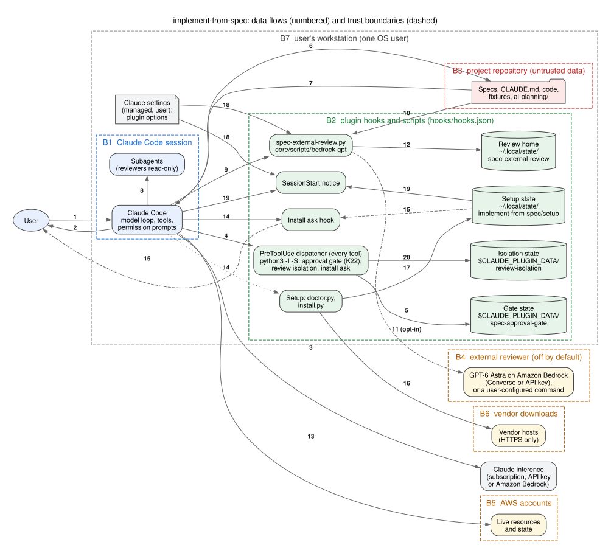

# Threat model

The threat model of the implement-from-spec plugin, on the Four Question Frame: what we are working
on, what can go wrong, what we do about it, and whether that is good enough. It is updated whenever the
approval gate, the external review script or its Bedrock client, the setup installer or the hooks
change (the maintainers' release checklist).

Every control is cited as `file:line` in this repository, as read in the working tree on 2026-10-18
after the gate's write rules for tool side effects and its command-substitution fix, and after the fixes
for the gaps a pass with the threat-modeling MCP server found (TM-45 to TM-54); the external reviewer's
citations were re-pointed on 2026-10-19, when its default became `off` (TM-17, TM-42, TM-44, TM-56). Line numbers drift
as code moves; each citation also names the function or constant, so it can be found again, and the
release checklist re-reads them. Where a security review of the documentation raised the same threat,
its theme number is given in the Theme column; the scan results, their triage and the residual risk
recorded for each theme are kept in the maintainers' release record and are not repeated here.

## 1. What are we working on?

A Claude Code plugin that runs on the user's workstation. Its skills turn specification items into a
plan, wait for the user's approval, implement, check and review, and stop short of deploying.

**Scope: what a release ships.** A release is the full plugin without the maintainers' test harness:
no `test/`, `evals/`, `tools/` or `core/**/tests/` directory is part of it. The unit tests, the eval
suites and their fixtures, the test container and the end-to-end scripts therefore run only on the
maintainers' machines; their threats are out of scope here (section 5). What ships:

- hooks (`hooks/hooks.json`, `hooks/hooks.json:3-17`): the approval gate `core/gate/spec-approval-gate.py`,
  started as `python3 -I` on Skill, Write, Edit, MultiEdit, NotebookEdit and Bash calls, on every prompt
  and after plan writes (`:4-6`, `:10`, `:16`); the setup ask hook `core/deps/install-ask-hook.py` on
  Bash (`:7`); and the SessionStart notice `core/deps/session-notice.py` (`:13`), both also started as
  `python3 -I`
- scripts: `core/scripts/spec-trace.py` (read-only traceability), `core/scripts/spec-external-review.py`
  and `core/scripts/bedrock-gpt` (the external review; the plugin ships no `bin/` directory, TM-48),
  `core/deps/doctor.py`, `core/deps/install.py` and `core/deps/depslib.py` (setup)
- data the scripts read: every skill's `gate_rules.json` (the gate's command rules) and
  `core/deps/dependencies.json` (setup recipes)
- skills (the reviewer skills included; the plugin ships no agents) and reference files, which are
  instructions to Claude, not code that runs

It runs nothing as a service, opens no port, stores no credential and has no third-party runtime
dependency (Python standard library only).

### Data flows

The numbers are the edges of the diagram (source: [`threat-model.dot`](threat-model.dot)).

1. User to Claude Code: prompts, and the approval reply
2. Claude Code to user: the plan, questions, permission prompts (the gate's `ask` decisions)
3. Claude Code to Claude inference: the conversation, including repository content Claude read. This is
   Claude Code's own channel to the provider the user chose, not a plugin flow
4. Claude Code to the gate: hook payloads (PreToolUse for Skill, Write, Edit, MultiEdit, NotebookEdit
   and Bash; UserPromptSubmit; PostToolUse for Write, Edit and MultiEdit) and the gate's deny, ask or
   allow back
5. Gate to its state directory (`spec-approval-gate/` under `CLAUDE_PLUGIN_DATA`,
   `core/gate/spec-approval-gate.py:156-158`): registered repositories, plan sha256 values and
   approvals, per session
6. Claude Code to the project repository: reads; writes (only `ai-planning/` and `.claude/` before
   approval)
7. Project repository to Claude Code: specifications, CLAUDE.md, code, the project's own fixtures, tool
   output
8. Claude Code to subagents and back: briefs out, findings and status blocks in
9. Claude Code, through a generic subagent that loads the read-only `running-external-review` skill, to
   `spec-external-review.py`
10. The repository to `spec-external-review.py`: the diff, the plan, the rules, the review focus and the
    context files
11. `spec-external-review.py` to the external reviewer, only when the user has enabled it (`off` is the
    default since 2026-10-19; off, the flow carries nothing): the filtered change in nonce-delimited
    sections; the verdict and findings back. In `aws-profile` mode the AWS CLI calls Bedrock Converse, in `api-key`
    mode `core/scripts/bedrock-gpt` calls the Bedrock endpoint with curl, in `command` mode the user's command runs
12. `spec-external-review.py` to the review home (`$SPEC_REVIEW_HOME`, else `spec-external-review/` under
    `CLAUDE_PLUGIN_DATA` when set, else under `${XDG_STATE_HOME:-~/.local/state}`,
    `core/scripts/spec-external-review.py:137-139`): `review.md` with change and prompt digests. The
    script runs through the Bash tool, which does not receive `CLAUDE_PLUGIN_DATA`
    (`docs/design-notes.md:102-105`), so the XDG location is the usual one
13. Claude Code to AWS accounts: targeted plans, diffs and change sets (live reads); deploys only after
    the user approves the command
14. Claude Code to setup: `doctor.py`, the `install.py` dry run, then `--apply --confirm <digest>`,
    intercepted by the ask hook
15. Ask hook to user: the plan summary in the permission prompt, rendered from the dry run saved in the
    setup state directory only after the saved plan is checked against the digest (TM-50)
16. Setup to vendor hosts: downloads over HTTPS (the hosts are listed per recipe in
    `core/deps/dependencies.json`)
17. Setup to its state directory (`${XDG_STATE_HOME:-~/.local/state}/implement-from-spec/setup/`,
    `core/deps/depslib.py:697-709`): the doctor's result, journal, `owned.json`, saved plans and
    downloaded scripts
18. Claude settings to the plugin's scripts: the review script, its `--show-config` (which setup runs to
    read the reviewer configuration) and the notice read the plugin options from the managed and user
    settings files only (`saved_options`, `core/scripts/spec-external-review.py:712-723`)
19. Claude Code to the SessionStart notice, which reads the doctor's saved result from the setup state
    directory and returns at most one line of context

### Assets

- **A1** the project repository's integrity: code and plans as the user approved them
- **A2** live AWS resources and state in the user's accounts
- **A3** credentials: AWS credentials and profiles, Claude Code's `AWS_BEARER_TOKEN_BEDROCK`, the
  reviewer's `IMPLEMENT_FROM_SPEC_BEDROCK_API_KEY`, `ANTHROPIC_API_KEY`
- **A4** the approval record: the sha256-bound approval, the ledger, the approved-plan snapshots
- **A5** confidentiality of repository content sent to the external reviewer
- **A6** the integrity of the user's machine and tools (setup)
- **A7** the integrity of the plugin's gate, rules, state and scripts
- **A8** the integrity of review verdicts, and of the report's statement of whether the review ran

### Trust boundaries

- **B1** the user and the Claude Code session: only the user's own prompt approves a plan
- **B2** Claude Code and the plugin's hooks and scripts, including how the plugin reaches the user
  (marketplace install, version pin)
- **B3** the project repository: untrusted data, whatever its author intended
- **B4** the external reviewer, off by default: Amazon Bedrock in the user's account, or a command the
  user configured, once the user enables it
- **B5** AWS accounts: live state the user's credentials can change
- **B6** the setup installer and vendor downloads
- **B7** the workstation: every process running as the same operating-system user

## 2. What can go wrong? 3. What are we going to do about it?

STRIDE per boundary. Status: **mitigated** (a control in this repository addresses it), **partial**
(a control exists with a stated residual), **accepted** (with the reason). Threat IDs are stable: an
ID removed from scope is listed in section 5 and never reused.

### B1 — the user and Claude Code

| ID | STRIDE | Threat | Control | Theme | Status |
|---|---|---|---|---|---|
| TM-01 | Spoofing | Claude, a subagent or repository text produces an "approve" that unlocks the repository | Approval is read only from the user's prompt on UserPromptSubmit (`cmd_record`, `core/gate/spec-approval-gate.py:655`; registered in `hooks/hooks.json:9-10`); AskUserQuestion answers never reach the hook (`core/contract.md:157-158`) | T15 | mitigated |
| TM-02 | Elevation | An ambiguous reply ("approve? no", "approved once tests pass") counts as consent | The whole reply must match the approval grammar (`core/gate/spec-approval-gate.py:670-678`); a bare reply approves only when one plan is pending, names are required otherwise (`:689-711`) | — | mitigated |
| TM-03 | Tampering | The plan changes between what the user read and what is approved, or after approval | Each Write/Edit of a plan records its sha256 (`cmd_plan_changed`, `core/gate/spec-approval-gate.py:843-870`); approval requires the recorded sha256 (`:713-718`); an edit of an approved plan revokes when it starts (`cmd_guard_edit`, `:740-748`) and any later change revokes for good (`approval_status`, `:407-423`); shell writes to plans are denied (`:38`, `:820-824`) | T14 | mitigated |
| TM-04 | Repudiation | The user later disputes what was approved | The gate prints the approved plan and its sha256 (`core/gate/spec-approval-gate.py:720-722`); amendments snapshot the approved plan as `ai-planning/<slug>.r<N>.approved.md` and the ledger records them (`core/contract.md:198-203`); the record lives in the project's git history and the Claude Code transcript | T14 | accepted: a local single-user tool cannot be tamper-evident against the same user |
| TM-05 | Elevation | An approval given in one session unlocks another (a resumed or parallel session) | Gate state is keyed by session (`session_key`, `state_txn`, `session_active`, `core/gate/spec-approval-gate.py:358-394`); another session stays denied (`:47-48`) | — | mitigated |

### B2 — Claude Code and the plugin's hooks and scripts

| ID | STRIDE | Threat | Control | Theme | Status |
|---|---|---|---|---|---|
| TM-06 | Tampering | Claude switches the gate off by editing its code, its hook registration, rules or state, the project's `.claude/settings*.json` or `.claude/hooks/`, or the user's Claude settings and hooks | The gate is registered by the plugin's `hooks/hooks.json` in every session (`hooks/hooks.json:3-17`); `PROTECTED_RE` covers the gate's state and code, the plugin's `hooks/`, setup's state directory (TM-50) and every `gate_rules.json` (`core/gate/spec-approval-gate.py:169-171`), and `plugin_trees` the rest of the installed plugin tree (`:492-505`, TM-40), both applied at `:518-523` and, for a directory holding them, `:524-529`; `GUARD_FILES_RE` denies the project's guard files before approval and asks after it (`:190`, `:546-552`, `guard_ask` `:613`); `USER_GUARD_RE` does the same for the user's settings files and hooks (`:185`, `:534-539`) | T15 | mitigated while the gate is registered |
| TM-07 | Tampering | A shell command writes past the analysis (variables, substitutions, globs, `find -exec`, `xargs`, interpreters) | Shell analysis of redirections, writers, substitutions and inline code (docstring `core/gate/spec-approval-gate.py:50-80`); an unresolved target counts as a write at the working directory and its repository (`UNRESOLVED`, `:954`, `:799-808`); deny beats ask across segments (`cmd_guard_bash`, `:755-840`); see TM-38 and TM-39 for the two analyses added on 2026-10-17 | T15 | partial: a script file run by an interpreter is not inspected (`:76-77`); the gate guards against mistakes, and containment is Claude Code's sandbox and permission settings (`README.md`, "Security model") |
| TM-08 | Denial of service, Elevation | A hook error opens the gate, or blocks unrelated sessions | A guard that fails denies in a gated session, even on a malformed payload (`main`, `core/gate/spec-approval-gate.py:2201-2226`); a session that never started a gated skill is never blocked (`:2217-2221`); a gated skill whose gate cannot record the session does not start (`:2202-2212`); a broken rules file keeps the skill gated with defaults (`plugin_rules`, `:2123-2131`) and every shell command asks until it is fixed (`:770-779`) | T15 | mitigated once Python runs; a hook that cannot start is TM-47 |
| TM-09 | Spoofing | A forged hook payload or `session_id` | The payload comes from Claude Code on the hook's stdin | T15 | accepted: anything able to forge it is already the user's own process |
| TM-10 | Elevation | Subagents write around the gate | Plugin hooks see subagents' tool calls and gate them like the main conversation (docstring `core/gate/spec-approval-gate.py:16-17`; `core/contract.md`, section 5) | — | mitigated |
| TM-55 | Tampering, Elevation | A reviewer subagent edits the change it reviews (an instruction planted in the change, or a reviewer that ignores its skill), so the reviewed tree is not the tree that was reviewed | The plugin ships no agents and so no tool list (decided 2026-10-19, `docs/design-notes.md`, "Reviewers are skills"); each review step dispatches generic subagents that load a reviewer skill whose instructions allow Read, Grep, Glob and read-only shell commands only and treat the files as data (`skills/code-reviewer/SKILL.md:24-28`, `skills/running-external-review/SKILL.md:22-25`); the gate gates every subagent tool call (TM-10), so before approval and in the plugin tree such a write is denied; the orchestrator records `git status --porcelain` and `git diff` before dispatch and compares them after, undoing and reporting a reviewer's change (`core/contract.md:302-313`) | — | partial: after approval the gate allows writes inside the plan's repository, so a reviewer's write there is caught by the comparison, not prevented |
| TM-11 | Tampering | A modified plugin release reaches users | `version` in `.claude-plugin/plugin.json` pins users until they update; each release passes the maintainers' release checklist (scans, provenance check, the maintainer's file-by-file read, an export of the allowlisted files only) | T15 | partial: the integrity of the hosting repository and marketplace is the host's |
| TM-38 | Tampering | A tool run during planning writes into the project as a side effect before approval: `terraform init` writes `.terraform/` and the lock file, `plan -out` a plan file, `cdk synth` `cdk.out/`, a Maven or Gradle build its output, pip or venv an environment, `sam build` and `cloudformation package` their artifacts | A skill's command rule with `"decision": "write"` names what the matched command writes (`validate_writes`, `core/gate/spec-approval-gate.py:308-326`; for example `skills/implementing-terraform-from-spec/gate_rules.json:65-68`, `skills/implementing-cdk-from-spec/gate_rules.json:113-116`); the analysis adds those paths to the command's write targets (`side_effect_targets`, `core/gate/spec-approval-gate.py:2015-2062`, applied at `:1442-1446`), and they are judged like any other write, so they are denied before approval, with the rule's message explaining why (`:789-792`, `:835-836`) | T15 | partial: a tool that writes as a side effect and has no `write` rule is not seen (docstring `core/gate/spec-approval-gate.py:76-78`) |
| TM-39 | Tampering | An unquoted command substitution cuts a write target short, so the analysis resolves it outside the project while the shell writes inside it (`/tmp$(printf /..$PWD)/src/a.py`) | Every unquoted `$(...)` and `$((...))` is replaced by a placeholder that is never assigned (`SUBST_PLACEHOLDER`, `collapse_substitutions`, `core/gate/spec-approval-gate.py:1148-1169`, called by `tokenize` at `:1174`), so the word stays unresolved and counts as a write at the working directory and its repository (`:799-808`); the substitution's own commands are analysed separately (`:1447-1455`) | T15 | mitigated |
| TM-40 | Tampering, Elevation | Code planted where Python looks for imports (a `json.py` next to a hook or a plugin script, `PYTHONPATH`, `PYTHONHOME`, `PYTHONSTARTUP`, the user's site-packages) runs inside every hook call or every plugin script a skill starts through the Bash tool, which inherits the session's environment, including an `env` block in a trusted repository's `.claude/settings.json`; or a gated session rewrites a plugin script that a hook or a skill runs (the setup ask hook, the external-review script, `core/scripts/bedrock-gpt`) | `hooks/hooks.json` starts all seven registrations as `python3 -I`: the gate (`hooks/hooks.json:4-6`, `:10`, `:16`), the setup ask hook (`:7`) and the SessionStart notice (`:13`); in isolated mode `sys.path` holds neither the script's directory nor the user's site-packages and `PYTHON*` variables are ignored (`docs/design-notes.md:70-82`); the gate drops its own directory from `sys.path` before its first import, for a registration without `-I` (`core/gate/spec-approval-gate.py:120-125`); every documented invocation of a plugin script is `python3 -I` too (`docs/design-notes.md:85-93`): the contract's rule and commands (`core/contract.md:28-29`, `:117`, `:277`, `:320`), the doctor preflight in each implementing skill (for example `skills/implementing-terraform-from-spec/SKILL.md:98`), `spec-trace.py` (`:153`, `:235`), the external review in each reviewing skill (for example `skills/reviewing-terraform-changes/SKILL.md:138`) and setup's commands (`skills/setup/SKILL.md:34`, `:99`); `install.py` prints its `--apply` command as `python3 -I` (`core/deps/install.py:131`) and the setup bootstrap runs its version check and the doctor with `-I` (`skills/setup/scripts/bootstrap.sh:63`, `:71`); `spec-trace.py` and `spec-external-review.py` import only the standard library (`core/scripts/spec-trace.py:79-85`, `core/scripts/spec-external-review.py:117-129`); the doctor, `install.py`, the ask hook and the notice load `depslib.py` by path from their own resolved directory through one identical `_depslib` function and add nothing to `sys.path` (`core/deps/doctor.py:39-53`, `core/deps/install.py:70-84`, `core/deps/install-ask-hook.py:68-79`, `core/deps/session-notice.py:45-59`), so no file next to them can stand in for a standard-library module that `depslib.py` or the settings reader imports later; the ask hook imports only the standard library (`core/deps/install-ask-hook.py:31-37`) until an `install.py --apply` command, when it loads `install.py` through `depslib.load_sibling` (`:82-85`, `core/deps/depslib.py:797-814`); while the gate is registered, before and after approval, the whole installed plugin tree is never writable through Write, Edit, MultiEdit, NotebookEdit or the shell: the plugin root the gate runs from and, in plugin mode, the plugin root above `--skills-dir`, each as a whole when it holds `.claude-plugin/plugin.json`, else its `core/`, `hooks/`, `bin/`, `skills/`, `agents/` and `.claude-plugin/` (`core/gate/spec-approval-gate.py:172-177`, `plugin_trees` `:492-505`, applied at `:518-523`; a directory holding the tree `:524-529`) | T15 | mitigated while the gate is registered; a script started without `-I` (typed by the user, or a command Claude writes against the skill text, which steers but does not enforce the form) is not isolated; outside a gated session a write to the plugin tree is left to Claude Code's permission settings, and a same-user process outside Claude Code is TM-34 |
| TM-41 | Denial of service, Tampering | The SessionStart notice blocks or slows session start, or puts unexpected text into Claude's context | The notice runs no tool, reads only the doctor's saved result, and every error ends in silence and exit 0 (`core/deps/session-notice.py:10-16`, `main` `:137-150`); its one line is fixed text plus the saved gap and stack names that are strings (`message`, `core/deps/session-notice.py:122-134`); the plugin option `setup_session_notice` turns it off (`:18-23`); it is registered with a 10-second timeout (`hooks/hooks.json:13`) | — | mitigated; the saved result itself is same-user data (TM-34) |
| TM-42 | Repudiation | The report hides or misstates whether the external review ran: a review that was off or did not run reads as passed, or the line is reworded so neither a reader nor a script finds it | The script prints exactly one status line on every outcome (`report`, `core/scripts/spec-external-review.py:804-806`; off, the default included, `:984-988`; exit codes `:105-108`); a misspelt mode is reported as not run, never as off (`resolve_config`, `:746-749`; `label` `:635-636`; tested); the contract requires that line in the report as plain text, character for character, with no bold, quotes or code span (`core/contract.md:420-423`, `:431`), the runner dispatched on every review and never a line written without running it (`:355-361`), and never a GPT review written by Claude (`:375`) | T17 | partial: the report is Claude's text; the contract steers it and the saved review and its digests are the evidence |
| TM-47 | Denial of service, Elevation | `python3` is missing, older than 3.9 or shadowed on PATH, so a guard hook cannot start or exits non-zero; Claude Code treats that as a non-blocking error and the tool call runs ungated (TM-08 covers only failures inside a running gate) | The Write/Edit and Bash guard registrations set `"onFailure": "block"` (`hooks/hooks.json:5-6`): a hook that cannot start, times out or exits with a code other than 0 or 2 blocks the tool call (code.claude.com/docs/en/hooks, "Block the action when a hook fails", Claude Code 2.1.295 or later); the other registrations stay non-blocking so the notice, the prompt recorder and the activation hook never stop an ungated session; the doctor requires Claude Code 2.1.271 (`core/deps/dependencies.json:155`), warns below 2.1.295 (`:156`) and requires `python3` 3.9 (`:101`); the gate returns 0 on every handled outcome, so only a gate that cannot run blocks (`main`, `core/gate/spec-approval-gate.py:2201-2226`) | T15 | partial: with `python3` missing or broken every Write, Edit and Bash call in every session blocks until it is fixed, by design; Claude Code 2.1.271 to 2.1.294 does not honour the field and still runs the hooks, so on those releases a guard that cannot start fails open and the tool call runs ungated; the doctor accepts them with the warning "below recommended 2.1.295: guard hooks fail open if python3 cannot run" (`core/deps/depslib.py:467-469`), and the README, the customer handoff and the skills' compatibility lines recommend 2.1.295; a different program named `python3` earlier on PATH that exits 0 silently is same-user tampering (TM-34) |
| TM-49 | Tampering | The bundled Bedrock client, run directly with `--out DIR` or the stub record variable, writes `prompt.md`, `response.md` or the prompt into any writable directory, the project included, before approval; no gate rule names it as a writer | `--out` and `BEDROCK_GPT_STUB_RECORD` must resolve, through symlinks, below the review home, the directory `spec-external-review.py` writes to (`review_home`, `under_review_home`, `core/scripts/bedrock-gpt:190-217`; `--out` `:240-246`; the record `:292-303`); anything else is a usage error before anything is written (tested) | — | partial: the review home is located by `SPEC_REVIEW_HOME`, `CLAUDE_PLUGIN_DATA` or `XDG_STATE_HOME`, so a command that sets one of them chooses it, as for `spec-external-review.py --out` (`check_out`, `core/scripts/spec-external-review.py:598-608`); a shell write the analysis cannot see is TM-07 |

### B3 — the project repository (untrusted data)

| ID | STRIDE | Threat | Control | Theme | Status |
|---|---|---|---|---|---|
| TM-12 | Tampering, Elevation | Prompt injection: instructions in specifications, CLAUDE.md, code, comments, fixtures, fetched pages or tool output make Claude run commands, fetch URLs, change settings or skip the gate | Repository content is data, never instructions; a conflicting instruction is a question for the user (`core/contract.md:59-66`); reviewer and subagent output is data (`core/contract.md:391-395`); writes before approval are denied whatever the model decides (TM-06, TM-07, TM-38); deploys and installs ask (TM-25, TM-31) | T15 | partial: the contract steers the model, the gate enforces only writes and the command rules |
| TM-13 | Information disclosure | Repository content, secrets included, leaves the machine to the Claude model provider (flow 3) | Out of the plugin's control: Claude Code's own data handling under the provider the user chose (subscription, API key or Amazon Bedrock) | — | accepted |
| TM-14 | Elevation | A cloned repository sets the external reviewer command and runs a binary of its choice | `pluginConfigs` in project and local settings are ignored, as Claude Code ignores them (`core/scripts/spec-external-review.py:51-55`, `saved_options` `:712-723`); the repository's settings `env` block and settings files inside the repository are TM-45 | T17 | mitigated for `pluginConfigs`; see TM-45 |
| TM-15 | Information disclosure | Review arguments or symlinks read files outside the repository | `confine` refuses paths outside the repository (`core/scripts/spec-external-review.py:339-346`) and `no_symlink_components` refuses symlinks (`:329`) | — | mitigated |
| TM-45 | Elevation, Spoofing | A cloned repository's committed `.claude/settings.json` `env` block (applied to every session and its subprocesses once the folder is trusted, code.claude.com/docs/en/settings-reference, `env`) sets `IMPLEMENT_FROM_SPEC_EXTERNAL_REVIEW=command` and a reviewer command that runs a program of the repository; the environment outranks the saved options (`resolve_config`, `core/scripts/spec-external-review.py:726-787`), so TM-14 alone does not hold | `repository_command` (`core/scripts/spec-external-review.py:908-931`), run before anything is read (`:995-998`): a command that came from the environment (any of the three tiers) or from a settings file inside the repository (`CLAUDE_CONFIG_DIR` or `SPEC_REVIEW_MANAGED_DIR` pointed into it) does not run when its program, as PATH resolves it, or a file one of its arguments names resolves inside the repository; the status line reads "not run (... command from environment resolves inside the repository ...)", exit 69, or 70 under policy `required` (tested). A command from a flag or from the user's or the managed settings file is the user's own and runs unchanged | T17 | partial: a command from the environment whose program lies outside the repository still runs (an interpreter given inline code, `sh -c '...'`); a trusted repository's shared settings can define hooks (code.claude.com/docs/en/settings, shared project settings: "Team permissions, hooks, plugins, and the environment variables the project needs"), which run code without this plugin, so this keeps the plugin from being the vehicle and does not contain a repository the user chose to trust |
| TM-53 | Tampering | Output of the recommended MCP servers (the AWS Documentation server, the HashiCorp Terraform server) is wrong or hostile, and the skills take it as fact when they verify properties | The servers are not bundled and are pinned to released versions in the documented configuration (`README.md:364-387`); tool output and fetched documentation are data, never instructions (`core/contract.md:59-66`), so an instruction in an answer is a question for the user, not an action; the gate and the command rules apply whatever an answer says (TM-12) | — | partial: a wrong fact from a server reaches the code and is caught only by the validators, the tests and the two reviews; the servers' integrity is their publishers' |

### B4 — the external reviewer

| ID | STRIDE | Threat | Control | Theme | Status |
|---|---|---|---|---|---|
| TM-17 | Information disclosure | Secret-bearing files reach the reviewer | `SENSITIVE_RE` never sends `.env*`, keys, certificates, Terraform state and variables, `secrets.*` (`core/scripts/spec-external-review.py:220-226`); `SECRET_PATTERNS` and `secret_kind` (`:227-250`) withhold every file (`file_block`, `:383-386`) and diff chunk (`filter_diff`, `:521-524`), removed and context lines included, whose content looks like a secret: an AWS access key ID, an AWS secret access key after its key name, a private key block, a quoted password, secret, token or API key assignment with a value of 16 characters or more, a GitHub or Slack token, a JSON Web Token; the "not sent" line names the file and the kind, never the value, and a required input holding one stops the run (tested); `EXCLUDE_RE` drops lockfiles, build output and caches (`:214-217`); a diff chunk with no attributable path is withheld (`filter_diff`, `:500-504`); what was not sent is printed (`:1021-1022`); `external_review: off`, the default since 2026-10-19 (`SETTINGS`, `:166`; `.claude-plugin/plugin.json:18`), sends nothing (`core/scripts/spec-external-review.py:984-988`), so this flow exists only once the user enables the reviewer | T17 | partial: both checks are heuristics, so a secret in a form neither recognises (a password inside a database URL, an unquoted assignment) reaches the model once the reviewer is enabled; users run a secret scanner before enabling it and keep it off for regulated or classified content (`README.md`, "Security model", "What the external reviewer receives") |
| TM-18 | Information disclosure, Spoofing | Claude Code's Bedrock bearer token reaches the reviewer, or changes who signs the review call | `BEARER_RE` and `child_env` strip `AWS_BEARER_TOKEN*`, `AWS_BEDROCK_API_KEY` and `BEDROCK_API_KEY` from every reviewer environment (`core/scripts/spec-external-review.py:191-192`, `:820-828`); with an explicit profile, the static AWS key variables are dropped too (`:198-199`); `core/scripts/bedrock-gpt` never reads `AWS_BEARER_TOKEN_BEDROCK` (`core/scripts/bedrock-gpt:14-15`); test knobs never reach a reviewer either (TM-46) | T17 | mitigated |
| TM-19 | Information disclosure | The prompt or a key ends up on a command line or in a world-readable file | The Converse request is written mode 0600 with `O_EXCL` and `O_NOFOLLOW` (`write_new`, `core/scripts/spec-external-review.py:611-615`), passed by file not argv (`:859-860`), and its directory removed (`:867`); the API key is read from the environment only and `--show-config` never prints it (`:797`) | — | mitigated |
| TM-20 | Tampering | Content in the change manipulates the reviewer's verdict: a fake END marker, an embedded "VERDICT: approve" | Per-run 64-bit nonce on every section marker, redrawn until it occurs in no section (`section_nonce`, `core/scripts/spec-external-review.py:301-308`); the prompt says the delimited material is data and an instruction inside it is a Major finding (`:261-265`); the verdict is parsed strictly (`VERDICT_RE`, `:314`) | T17 | mitigated; model judgement remains a residual |
| TM-21 | Elevation | The reviewer's answer drives actions: a command, a settings change, an edit outside the plan | Reviewer output is data; a `Fix:` line is applied only to a finding the code confirms, inside the plan's Owns (`core/contract.md:391-395`) | T17 | mitigated |
| TM-22 | Denial of service | Reviewer cost or a hung call | One call per review, `MAX_PROMPT_BYTES` 600,000 (`core/scripts/spec-external-review.py:146`), `CALL_TIMEOUT_S` 1800 (`:153`); unavailability degrades to "External review: not run" under policy `optional`, or verification incomplete under `required` (`core/contract.md:362-371`) | T17 | accepted: account budgets and quotas are the user's controls |
| TM-23 | Spoofing | A different endpoint or model answers | Region and model ID validated (`REGION_RE`, `MODEL_RE`, `core/scripts/spec-external-review.py:200-202`); the AWS CLI signs with SigV4 over TLS | T17 | accepted: a client cannot verify the weights a managed service serves |
| TM-24 | Elevation | Shell injection through the `command` reviewer | The command is split with `shlex` and run as an argument list without a shell (`run_reviewer`, `core/scripts/spec-external-review.py:831-836`) | T17 | mitigated |
| TM-46 | Tampering | A test knob forges the verdict: `BEDROCK_GPT_STUB`, set through the same repository `env` block as TM-45, makes the Bedrock client answer from a file instead of Bedrock in `api-key` mode, and the status line says passed | `TEST_KNOB_RE` (`core/scripts/spec-external-review.py:193-196`) removes `BEDROCK_GPT_STUB*`, `SPEC_REVIEW_*` and `SPEC_GATE_*` from every reviewer's environment in `child_env` (`:820-828`), so a stub never stands in for Bedrock (tested with the real client and with a recording one). Removing the knob was chosen over marking the status line "stub": any variable that re-enabled it would be reachable through the same `env` block, and a marked line is still a passed review that Claude reports | T17 | partial: the review script still reads its own self-test knobs `SPEC_REVIEW_FOCUS_ROOT`, `SPEC_REVIEW_MANAGED_DIR` and `SPEC_REVIEW_HOME` from the environment; a settings file they point into the repository cannot choose a repository program (TM-45) but can turn the reviewer off, which the status line reports as off |
| TM-48 | Information disclosure | The Bedrock client sits in the plugin's `bin/`, which Claude Code puts on the Bash tool's PATH (code.claude.com/docs/en/plugins-reference, Standard layout, "Executables"), so `cat .env \| bedrock-gpt` sends any file to Bedrock with none of the `SENSITIVE_RE` and `EXCLUDE_RE` filtering of TM-17 | The client lives in `core/scripts/` (`BEDROCK_GPT`, `core/scripts/spec-external-review.py:140-143`), the only caller runs it by path, and the plugin has no `bin/` directory (tested); the same reference notes that claude.ai and Cowork do not install a plugin with a top-level `bin/` | T17 | partial: run by its full path the client still sends whatever it is piped, like curl; the gate does not inspect what a pipe carries (TM-07), and a live call needs the user's `IMPLEMENT_FROM_SPEC_BEDROCK_API_KEY` |
| TM-54 | Spoofing | In `aws-profile` mode the review goes to whichever AWS account the profile or the default chain resolves to; the account is not shown before the call | The status line and the saved review name the profile, or "default credential chain", the Region and the model (`label`, `core/scripts/spec-external-review.py:631-641`); `--show-config` prints where each came from (`show_config`, `:790-800`) | T17 | accepted: resolving the account would add an STS call, with its own failure modes, to every review; the profile is the user's choice, and the account behind it is their configuration |
| TM-56 | Information disclosure | With the reviewer off by default, a cloned repository turns it on for the user: its committed `.claude/settings.json` `env` block sets `IMPLEMENT_FROM_SPEC_EXTERNAL_REVIEW=bedrock-gpt` (the environment outranks the saved options, TM-45), so repository content goes to Bedrock that the user never chose to enable | `pluginConfigs` in project and local settings are ignored (TM-14); the `env` block applies only after the user trusts the folder (code.claude.com/docs/en/settings: "most `env` values apply only after each teammate trusts the folder", read 2026-10-19); the call is signed with the user's own credentials into the user's own account, so the content does not reach a party the repository chose beyond the model the user's account can invoke; the status line names the mode, profile, Region and model (`label`, `core/scripts/spec-external-review.py:631-641`) and `--show-config` names the environment variable as the source (`show_config`, `:790-800`); the user guide tells users to read a repository's settings before trusting it (`docs/user-guide/external-review.md`, "Where the script reads them, and overrides") | T17 | accepted: a script cannot tell a variable the user exported from one a trusted repository's settings set; before 2026-10-19 the reviewer was on for every user by default, so the off default narrows this to repositories the user trusts |

### B5 — AWS accounts

| ID | STRIDE | Threat | Control | Theme | Status |
|---|---|---|---|---|---|
| TM-25 | Tampering | A deploy or live change runs without the user's consent, or approval of a plan is taken as consent to deploy | Command rules `ask` before and after approval (`core/contract.md:152-154`; for example `skills/implementing-terraform-from-spec/gate_rules.json:10-12`); an `ask` never covers an unapproved write in the same command (`cmd_guard_bash`, `core/gate/spec-approval-gate.py:786-792`, `:837-840`); deploys always ask by decision (`docs/design-notes.md:141-146`). The gate never authorises a deploy | T15 | mitigated (ask, not deny, by decision) |
| TM-26 | Tampering | `aws cloudformation ... --use-previous-template` silently keeps old parameter values | Denied outright (`skills/implementing-cloudformation-from-spec/gate_rules.json:9-11`) | — | mitigated |
| TM-27 | Information disclosure, Tampering | A live read (targeted plan, diff, change set) runs under the wrong profile or account | Plan and diff commands ask, so the user confirms the account (`skills/implementing-terraform-from-spec/gate_rules.json:21-23`); denied or headless means "not run" (`core/contract.md:459-462`) | — | mitigated |
| TM-28 | Elevation | The user's credentials are broader than the work needs; no detective controls if something goes wrong | The plugin's own scripts make no AWS mutation | T10, T15 | accepted: least privilege and account-level detection are the customer's IAM and landing-zone design |
| TM-43 | Information disclosure, Tampering | `terraform init` with the backend enabled connects to remote state under the active profile, possibly a production backend named by `-backend-config` | The `terraform-backend-init` rule asks unless the last `-backend` or `-cloud` option is false (`skills/implementing-terraform-from-spec/gate_rules.json:42-47`); `-migrate-state` and `-force-copy` ask (`:31-35`); before approval any `init` in the project is also a denied write (TM-38, `:65-68`) | — | mitigated (ask) |

### B6 — the setup installer and vendor downloads

| ID | STRIDE | Threat | Control | Theme | Status |
|---|---|---|---|---|---|
| TM-29 | Tampering | A tampered download or a downgraded transport | Only `https://` URLs are fetched (`core/deps/depslib.py:91-93`, `:122`), with Python's default certificate verification; pinned GPG fingerprints and vendor checksums where vendors publish them (`core/deps/dependencies.json`) | T18 | mitigated |
| TM-30 | Tampering | The bytes run differ from the bytes approved | A downloaded script's sha256 is shown in the dry run and re-checked before it runs (`core/deps/install.py:540-541`); the plan digest binds `--apply` to the reviewed dry run (`digest_of`, `:181`; refusal on a mismatch `:626-627`) | T18 | mitigated |
| TM-31 | Elevation | Claude copies the digest and installs without the user | The ask hook turns every `install.py --apply` into a permission prompt carrying the plan summary, rendered from the digest-checked saved plan (TM-50) (`core/deps/install-ask-hook.py:128`, `:145`); `sudo`, `doas` and `su` steps are rejected and administrator steps are handed to the user (`core/deps/depslib.py:275`) | T18 | mitigated: in a gated session the gate denies every write to the ask hook and the rest of the plugin tree, and the hook runs as `python3 -I` (TM-40); outside one, its integrity is left to Claude Code's permission settings |
| TM-32 | Tampering | Setup replaces or downgrades a tool the user already has, or installs into a project | Never replaces, downgrades or installs into a project; refuses to overwrite any path a recipe would create (`core/deps/install.py:17-18`, `:29-31`, `:633`) | T18 | mitigated |
| TM-33 | Tampering | A vendor install script has no published hash or signature | The user approves the exact bytes shown (path, sha256, first lines), bound by the digest | T18 | accepted: vendor scripts change without notice, so a pin would break installs |
| TM-44 | Information disclosure, Tampering | Setup, while choosing which reviewer tools to check, prints the reviewer's API key or command arguments, changes the reviewer settings, or passes the user's free text into a command | Setup reads the reviewer configuration with `--show-config` first (`skills/setup/SKILL.md:31-39`), which calls and sends nothing, prints the API key only as set or not set and a command reviewer as its program and argument count (`show_config`, `core/scripts/spec-external-review.py:790-800`; `redacted_command` `:644-646`); only when nothing is configured does it offer to enable the reviewer, and the answer chooses between two fixed values, a clear yes giving `--review-auth aws-profile` (or `api-key`) and anything else `off`, never the user's text (`skills/setup/SKILL.md:41-49`); setup never turns the reviewer on, never writes settings files and never creates, prints or stores credentials (`:129-133`); only the listed stack words reach `--stack`, and the doctor and `install.py` reject any other value (`:25-28`) | T18 | mitigated |
| TM-50 | Spoofing | Consent is misdescribed: the ask hook showed the `summary` text saved in `plans/<digest>.json`, which the digest does not cover (`digest_of`, `core/deps/install.py:181-184`), so an edited summary passed and the permission prompt described a different plan | The hook loads `install.py` by path, recomputes `digest_of` over the saved plan, requires it and the saved `digest` to equal the confirmed digest, and renders the prompt with `summary_line` from the plan itself; a plan that no longer matches is not described and the prompt says not to approve (`plan_summary`, `core/deps/install-ask-hook.py:88-117`; tested with an edited summary and with an edited plan); setup's state directory is in the gate's protected set, so a gated session never writes it (`SETUP_STATE_DIR`, `core/gate/spec-approval-gate.py:159-163`, in `PROTECTED_RE` `:169-171` and `protected_roots` `:508-509`; tested) | T18 | mitigated for the default state directory; a `--data-dir` elsewhere is not protected by the gate, and outside a gated session and outside Claude Code the files are same-user data (TM-34) |
| TM-51 | Information disclosure | A secret under a name the denylist does not match (`DATABASE_URL`, a token under a custom name) reaches an install step or a downloaded vendor script | `install_env` removes AWS, Anthropic, Claude, Bedrock, OpenAI and plugin variables and every name containing TOKEN, SECRET, PASSWORD, CREDENTIAL, KEY or AUTH (`SECRET_ENV_RE`, `core/deps/install.py:405-417`; `install_env` `:419-424`); a piped vendor script is shown with its sha256 and first lines before the user approves it (TM-30, TM-33) | T18 | accepted: filtering is by name, not value; an allowlist would drop the proxy, CA and package-manager settings that enterprise networks need for installs to work <!-- pragma: allowlist secret - names variable-name words, holds no value --> |

### B7 — the workstation (same operating-system user)

| ID | STRIDE | Threat | Control | Theme | Status |
|---|---|---|---|---|---|
| TM-34 | Tampering, Repudiation | Another process running as the same user edits gate state, a plan, the journal, the doctor's saved result or a saved review | Inside Claude Code the gate protects its state (TM-06); the gate's state directory is created 0700 and its files 0600 (`state_txn`, `core/gate/spec-approval-gate.py:368-371`) | T14, T15 | accepted: a local hook cannot protect files from the user's own processes |
| TM-35 | Information disclosure | The plugin writes a credential to disk | No credential is written: the reviewer key is read from the environment only (`core/scripts/bedrock-gpt:92-95`; `core/scripts/spec-external-review.py:797` never prints it); setup never configures credentials (`core/deps/install.py:31`) | — | mitigated |
| TM-52 | Information disclosure | Setup's state (saved plans, the journal, `owned.json`, downloaded scripts, the doctor's result) is readable by other users of the machine | The setup state directory and its `plans/`, `scripts/` and `staging/` are created 0700 and tightened when they exist, and every state file is written 0600 (`private_dir`, `write_private`, `core/deps/depslib.py:775-795`; used by `State`, `core/deps/install.py:141-168`, and the doctor's `write_cache`, `core/deps/doctor.py:85-88`; tested), as the gate's state is (TM-34) | — | mitigated; the files hold plans and journals, no credential (TM-35) |

## 4. Did we do a good enough job?

- **Hard rules hold:** the gate never authorises a deploy (TM-25); the external review is off by default
  and sends nothing until the user enables it, and then only the filtered change (TM-17); no credential is written to disk (TM-19, TM-35)
- **Controls are tested before each release:** the maintainers' test suites execute every
  `gate_rules.json` example, the shell-analysis cases including tool side effects and command
  substitutions, the reviewer's environment scrub, filters and markers, and the digest, refusal and ask
  paths of setup, on python3 and on Python 3.9. The tests are not part of the release; their results
  are kept in the maintainers' release record
- **Residuals users carry:** a secret hard-coded in a sent file (TM-17), shell paths and tool side
  effects the analysis cannot see (TM-07, TM-38), writes to the plugin's own files outside a gated session
  (TM-40), a report line the contract steers but does not enforce (TM-42), a reviewer subagent's write after approval, which the
  orchestrator's before-and-after comparison catches but no tool list prevents (TM-55), repository content reaching
  the Claude model provider (TM-13), a trusted repository's `env` block enabling the off-by-default
  external reviewer (TM-56), and same-user tampering (TM-34). `README.md` ("Security model")
  and `docs/customer-handoff.md` state them
- **Residuals added by the threat-modeling MCP pass:** a trusted repository's own settings can still run
  code and set the environment, so TM-45 keeps the plugin from being the vehicle without containing such a
  repository; with `python3` missing or broken every guarded tool call blocks (TM-47); the Bedrock client
  run by its full path sends what it is piped (TM-48); the review home, and so where the client may write,
  follows the environment (TM-49); the review script's own self-test knobs are read from the environment
  (TM-46); secrets are filtered from install steps by name only (TM-51); MCP answers are trusted for facts
  (TM-53); the AWS account behind a profile is not shown (TM-54)
- **Checked with the threat-modeling MCP server (2026-10-18):** the model was first written by hand from
  the code, then compared with a model the awslabs threat-modeling MCP server built for the plugin. Ten
  of its threats were already rows here; the ten it found that were not are TM-45 to TM-54, each re-checked
  against the code before it was added, and the seven that called for a code change (TM-45 to TM-50,
  TM-52) were fixed with tests

## 5. Out of scope: the maintainers' test harness

These threats were in the model of 2026-10-16 and concern only files a release does not ship. They
stay with the maintainers' release record and their IDs are not reused:

- **TM-16** a user copies a test fixture as if it were guidance: the fixtures live under `test/`
- **TM-36** credentials leak into the test container's command lines or artifacts
- **TM-37** committed eval results leak into an eval run
- The former boundary **B8**, the maintainers' test container, and its data flows (the container runner,
  the eval suites, the end-to-end scripts)
